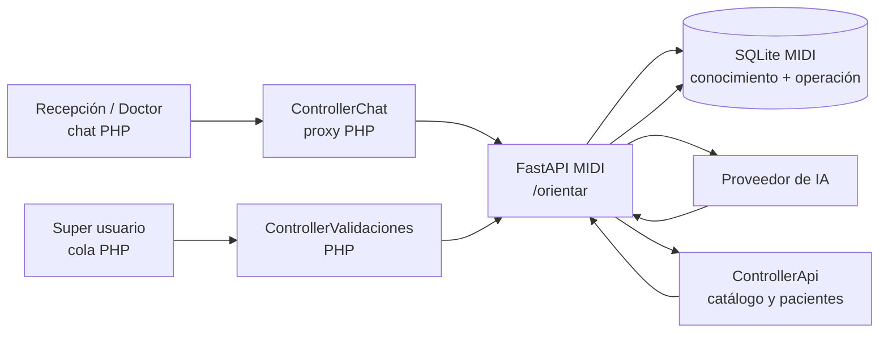
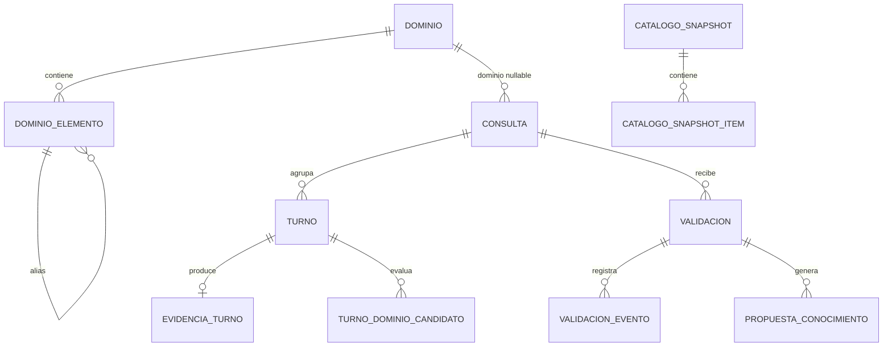

# Revisión clínica posterior y base de conocimiento relacional de MIDI

* **Author:** Juanxrpana
* **Status:** Draft
* **Date:** 2026-11-26

--------------------------------------------------------------------------------

## Overview

MIDI es el componente FastAPI que orienta al paciente hacia una especialidad del Centro de Especialidades Médicas Jehová Rafa. Hoy recomienda, pero no tiene un circuito formal para revisar la calidad de esa recomendación ni para convertir una corrección médica en conocimiento aprobado. La base de conocimiento clínica vive en archivos JSON, sin claves foráneas, y el aprendizaje se escribe automáticamente en cada consulta.

Este diseño añade tres piezas: una base de conocimiento relacional con `dominio` como raíz y claves foráneas reales; una validación posterior y opcional del especialista sobre la ficha y la respuesta final; y un índice determinista de confianza que marca los casos dudosos o multi-dominio para revisión. La validación no bloquea la recomendación: el paciente sigue siendo recomendado, no obligado a agendar. La cola de validación vive en el sistema PHP existente; FastAPI expone los endpoints y el super usuario asume los casos que el especialista no valide.

La primera fase elimina `knowledge/dominios.json` y `knowledge/aprendido.json` como fuente de verdad. Las columnas operativas `estado_json`, `datos_json`, `embedding` y `json_respuesta` se conservan en esta fase y se normalizan en una segunda fase acordada.

## The Problem

El sistema actual no puede demostrar qué pasó en una consulta concreta. `session_id` se reutiliza para varias consultas, `mensajes` no tiene `consulta_id` ni `turno_id`, `agregar_mensaje` no devuelve el identificador del mensaje y `auditoria` no se enlaza con el mensaje ni con la ficha. La ficha que recibe el LLM se construye en memoria y no se guarda. Por eso una corrección del doctor no se puede unir de forma fiable con la ficha, la respuesta, el mensaje y la auditoría exactos.

El conocimiento clínico está en JSON. `dominios.json` y `aprendido.json` se leen y se fusionan en memoria; no hay claves foráneas, no hay versión de conocimiento y no hay un registro de quién cambió qué. El aprendizaje automático guarda la frase del usuario en cada detección de dominio y `POST /conocimiento` escribe ejemplos y palabras de inmediato. Ninguna de esas rutas pasa por aprobación.

La detección de dominio devuelve la primera coincidencia por subcadena o el mejor ejemplo por similitud, sin puntajes, sin top-k y sin margen entre candidatos. `hay_alarma` usa la misma lógica. Una frase como «no tengo fiebre» coincide con `fiebre`; «sin dolor de pecho» coincide con `pecho`; «no tengo dificultad para respirar» puede disparar una alarma. No existe un índice que distinga un caso claro de uno ambiguo.

La base actual tiene 10 sesiones, 90 mensajes, 45 auditorías y 1 memoria. De las 45 auditorías, 30 no tienen dominio porque el flujo general no lo asigna. Hay 4 dominios, 19 preguntas, 39 palabras clave curadas que se reducen a 29 al normalizar, y 4 ejemplos aprendidos sin fecha ni estado. Cualquier migración que ignore esos datos produce una base incompleta o una detección distinta.

La validación médica tampoco tiene superficie. No hay cola, no hay rol verificado, no hay estados, no hay evidencia reproducible y no hay un responsable cuando el especialista no revisa. La API solo exige una clave compartida y confía en los headers de rol que envía PHP.

## Goals

* **Mover el conocimiento clínico a SQLite relacional.** `dominio` es la raíz; las listas del dominio se guardan en `dominio_elemento` con FK a `dominio`; `PRAGMA foreign_keys=ON` se aplica en todas las conexiones.
* **Eliminar los archivos JSON como fuente de verdad en la fase 1.** `dominios.json` y `aprendido.json` se convierten en un seed versionado; la aplicación lee de la base.
* **Dar identidad a la consulta y al turno.** Cada orientación final tiene `consulta_id`, `turno_id` y `mensaje_id`; la ficha, la respuesta, la auditoría y la validación se enlazan al mismo turno.
* **Guardar evidencia revisable sin duplicar la conversación.** Se guarda un resumen estructurado de la ficha y la respuesta final, con hashes, versiones de KB, prompt, modelo y catálogo.
* **Producir un índice de confianza explicable.** Se guardan los componentes del puntaje, el top-k de dominios candidatos y la versión del detector; la confianza solo marca revisión y no cambia la respuesta.
* **Permitir validación posterior y opcional.** El especialista de la especialidad es el revisor natural; si no valida, el super usuario de administración toma el caso. La cola y la pantalla viven en PHP.
* **Gobernar el aprendizaje.** Las correcciones y las propuestas de palabras o preguntas quedan pendientes; la publicación requiere aprobación y deja un registro de autor, motivo, origen y versión.
* **Migrar sin perder datos.** La migración conserva las 10 sesiones, 90 mensajes, 45 auditorías y 1 memoria; reporta los 39 términos convertidos en 29 y conserva alias cuando corresponda.
* **Hacer visible la operación.** Hay salud, métricas, registro de acceso a fichas y una cola con estados, edad y responsable.

Criterios medibles:

* Toda conexión de escritura tiene `foreign_keys=1` y `foreign_key_check` devuelve cero violaciones.
* La migración conserva los conteos actuales y falla de forma visible si la base queda sin dominios.
* Toda orientación final tiene consulta, turno, resumen de evidencia, confianza explicable y estado de revisión.
* Ninguna propuesta no aprobada cambia `detectar_dominio`.
* La cola permite al super usuario ver pendientes, filtrar, tomar un caso y decidir, con registro de quién lo vio.

## Non-Goals

* Obligar al paciente a agendar o bloquear la recomendación.
* Validar antes de enviar la respuesta en esta fase.
* Permitir que un doctor intervenga en vivo dentro del chat.
* Validar cada pregunta, el dominio o el razonamiento por parte del doctor.
* Reemplazar `mensajes`, `sesiones`, `memorias` o `auditoria`.
* Aprender automáticamente de la propia salida o publicar sin aprobación.
* Diagnosticar, prescribir o recomendar tratamientos y dosis.
* Normalizar `estado_json`, `datos_json`, `embedding` y `json_respuesta` en la fase 1; se hará en la fase 2 acordada.
* Construir la cola de validación en FastAPI; la interfaz vive en PHP.
* Escalar a múltiples workers en esta fase.

## Technical Plan (Architecture)

### 1. Vista general

La solución separa tres planos:

- **Conocimiento:** SQLite relacional con `dominio` como raíz y `dominio_elemento` como tabla única para las listas del dominio.
- **Operación:** sesiones, consultas, turnos, mensajes, evidencia y auditoría. Las tablas actuales se conservan.
- **Revisión:** validaciones y propuestas de aprendizaje, con cola en PHP y endpoints en FastAPI.

La fase 1 mueve el conocimiento a SQLite y añade identidad de consulta, evidencia, confianza y validación. `estado_json`, `datos_json`, `embedding` y `json_respuesta` siguen existiendo; su normalización es la fase 2.

### 2. Modelo de datos relacional

#### 2.1 Conocimiento

| Tabla | Columnas principales | Reglas |
|---|---|---|
| `dominio` | `id`, `clave`, `nombre`, `min_preguntas`, `max_preguntas`, `activo`, `orden`, `actualizado_en` | `clave` única e inmutable; borrado lógico con `activo=0`; `CHECK` de mínimos. |
| `dominio_elemento` | `id`, `dominio_id`, `tipo`, `clave`, `valor`, `valor_normalizado`, `orden`, `activo`, `origen`, `estado`, `catalogo_id`, `alias_de`, `creado_en`, `actualizado_en` | FK a `dominio`; `tipo` con `CHECK`; `catalogo_id` nullable FK; `alias_de` nullable FK a la misma tabla. |
| `catalogo_especialidad` | `id_categoria`, `nombre`, `activo`, `sincronizado_en` | PK por `id_categoria`; el nombre es dato de presentación y puede cambiar. |
| `catalogo_snapshot` | `id`, `tomado_en`, `ok`, `error` | Instantánea de la sincronización con PHP. |
| `catalogo_snapshot_item` | `snapshot_id`, `id_categoria`, `nombre` | Filas de la instantánea; FK a `catalogo_snapshot`. |

`dominio_elemento.tipo` acepta: `palabra_clave`, `senal_alarma`, `pregunta`, `especialidad`, `prueba`, `asociacion`, `descartar` y `ejemplo`.

Reglas de `dominio_elemento`:

- `UNIQUE (dominio_id, tipo, valor_normalizado)` para evitar duplicados normalizados.
- `UNIQUE (dominio_id, tipo, clave)` cuando `clave` no es nula; se usa para preguntas y elementos con identidad estable.
- `orden` no tiene `UNIQUE`; se ordena por `(orden, id)` para permitir intercambios sin valores temporales.
- `alias_de` permite conservar las 39 palabras originales aunque 29 sean las formas normalizadas; el alias no crea una nueva regla de detección.
- `origen`: `curada`, `aprendida`, `correccion_medica`, `auto_legacy`.
- `estado`: `aprobado`, `pendiente`, `rechazado`.
- `catalogo_id` solo se llena para `tipo='especialidad'` y solo si el catálogo está disponible.
- `valor_normalizado` se calcula con la misma función de `ai/cuestionario._normalizar`; se guarda `normalizer_version` en `kb_version` para poder reconstruirlo.

#### 2.2 Operación y evidencia

| Tabla | Columnas principales | Reglas |
|---|---|---|
| `consulta` | `id`, `session_id`, `id_usuario`, `id_paciente`, `flujo`, `dominio_id`, `estado`, `iniciada_en`, `cerrada_en` | `flujo` en `cuestionario`, `general`, `emergencia`, `otro`; `dominio_id` nullable; una consulta abierta por sesión. |
| `turno` | `id`, `consulta_id`, `seq`, `peticion_id`, `tipo_respuesta`, `origen_respuesta`, `degradado`, `creado_en` | FK a `consulta`; `UNIQUE (consulta_id, seq)`; `origen_respuesta` en `llm`, `regla`, `fallback`. |
| `evidencia_turno` | `id`, `turno_id`, `mensaje_id`, `resumen_ficha`, `ficha_hash`, `respuesta_hash`, `kb_version_id`, `prompt_version`, `modelo`, `catalogo_snapshot_id`, `confianza_total`, componentes, `revision_requerida`, `creado_en` | FK a `turno`; `UNIQUE (turno_id)`; se escribe en el turno final, no en cada aclaración. |
| `turno_dominio_candidato` | `id`, `turno_id`, `dominio_id`, `rank`, `score`, `termino`, `fuente` | FK a `turno` y `dominio`; `UNIQUE (turno_id, rank)`. |
| `validacion` | `id`, `consulta_id`, `evidencia_turno_id`, `revisor_id`, `revisor_rol`, `revisor_especialidad_id`, `dominio_original_id`, `dominio_corregido_id`, `especialidad_original_id`, `especialidad_corregida_id`, `motivo_codigo`, `comentario`, `decision`, `estado`, `creado_en` | FK a `consulta` y `evidencia_turno`; originales y correcciones nullable; no se actualiza, se añade evento. |
| `validacion_evento` | `id`, `validacion_id`, `estado`, `actor_id`, `detalle`, `creado_en` | Append-only; FK a `validacion`. |
| `propuesta_conocimiento` | `id`, `validacion_id`, `dominio_id`, `tipo`, `clave`, `valor`, `valor_normalizado`, `estado`, `generado_por`, `modelo`, `creado_en`, `aprobado_por`, `aprobado_en`, `aplicado_en`, `elemento_id` | `dominio_id` nullable para proponer un dominio nuevo; `elemento_id` nullable hasta aplicar. |
| `alerta_revision` | `id`, `consulta_id`, `turno_id`, `motivo`, `estado`, `creado_en` | Opcional si se separa la cola de la evidencia; evita un flag mutable duplicado. |
| `acceso_caso` | `id`, `consulta_id`, `usuario_id`, `rol`, `accion`, `creado_en` | Registra quién vio o decidió. |
| `kb_version` | `id`, `version`, `hash`, `normalizer_version`, `descripcion`, `autor`, `creado_en` | Una fila por publicación de conocimiento. |
| `schema_migrations` | `version`, `checksum`, `aplicada_en` | Control de migraciones. |

Las tablas existentes se modifican sin reemplazarlas:

- `mensajes` recibe `consulta_id` y `turno_id` nullable. `agregar_mensaje` devuelve `lastrowid`.
- `auditoria` recibe `consulta_id`, `turno_id`, `evidencia_turno_id`, `resultado` (`ok`, `fallback`, `error`) y `error_code`.
- `sesiones` y `memorias` no cambian en la fase 1.
- `mensajes` y `auditoria` no llevan FK a las tablas nuevas; sus columnas son nullable para no romper `DELETE /sesiones` ni la retención de auditoría.

### 3. Flujo de una consulta

1. PHP llama a `POST /orientar` con `consulta` y `session_id`.
2. FastAPI abre o recupera la `consulta` abierta de la sesión. Si la sesión ya cerró una consulta, crea otra. Crea un `turno` con `peticion_id` y `seq`.
3. Registra el mensaje del usuario y lo enlaza al `turno`.
4. Detecta candidatos de dominio. Si hay dominio, aplica el cuestionario. Si no, usa el flujo general.
5. Al finalizar, construye el resumen de la ficha, llama al proveedor, valida y calcula la confianza.
6. Guarda `evidencia_turno`, `turno_dominio_candidato`, el mensaje del asistente y la auditoría en una transacción por turno.
7. Marca `revision_requerida` si la confianza baja del umbral, si el margen es pequeño o si hay varios dominios candidatos.
8. Devuelve `RespuestaOrientacion` a PHP. La respuesta no cambia por la confianza.
9. La cola PHP consulta `GET /validaciones` y muestra solo el resumen de la ficha y la respuesta final.
10. El super usuario toma el caso y decide. La decisión se guarda como evento; si hay corrección, se crean propuestas pendientes.

La consulta se cierra cuando la respuesta es `orientacion`, `emergencia`, `derivar`, `catalogo` o cuando el flujo general termina. El siguiente mensaje de la misma sesión abre una consulta nueva.

### 4. Detección y confianza

Se sustituye `detectar_dominio` por dos funciones:

- `detectar_candidatos(texto, dominios)` devuelve una lista ordenada de candidatos con `dominio_id`, `score`, `rank`, `termino` y `fuente`.
- `detectar_dominio(texto)` se conserva como envoltorio para el código existente y devuelve el primer candidato que supera el umbral; si no hay, `None`.

El puntaje se calcula con componentes persistidos:

| Componente | Cálculo | Uso |
|---|---|---|
| `coincidencia_keyword` | Mejor coincidencia de palabra clave con límites de palabra y polaridad. | Evidencia principal. |
| `similitud_ejemplo` | Jaccard con ejemplos aprobados. | Variantes de frase. |
| `margen_top1_top2` | Diferencia entre el primer y el segundo candidato. | Ambigüedad entre dominios. |
| `num_candidatos` | Cantidad de dominios que superan el umbral. | Multi-dominio. |
| `preguntas_respondidas` | Respuestas válidas sobre el mínimo del dominio. | Cobertura del cuestionario. |
| `penalizacion_negacion` | Negación detectada en la ventana de la frase. | Evita «no tengo fiebre». |

La fórmula y los pesos se guardan con `scoring_version`. El umbral inicial es `confianza >= 0.60` y `margen >= 0.15`, configurables en `config/settings.py`; son provisionales hasta tener validaciones suficientes. `revision_requerida` se activa si:

- `confianza_total < umbral_confianza`;
- `margen_top1_top2 < margen_minimo`;
- hay dos o más dominios por encima del umbral;
- el tipo de respuesta es `catalogo` o `derivar`.

La confianza operativa (`catalogo no disponible`, `proveedor en fallback`) se guarda como `degradado` y no entra en la cola clínica. La confianza del LLM, si se añade, se guarda como `confianza_llm` y no decide el flag en la fase 1.

La negación se trata con una ventana de tokens anteriores y posteriores a la coincidencia: `no`, `sin`, `niega`, `ausencia de`, `nunca`. Una coincidencia negada no suma como evidencia positiva y se registra en `termino` con polaridad negativa. El set dorado de pruebas incluye «no tengo fiebre», «sin dolor de pecho», «no tengo dificultad para respirar» y frases con dos dominios.

### 5. Evidencia y validación

`evidencia_turno` guarda:

- `resumen_ficha`: motivo, respuestas, antecedentes relevantes, dominio, especialidad y resultado;
- `ficha_hash`: hash del texto exacto que recibió el LLM;
- `respuesta_hash` y la respuesta final;
- `kb_version_id`, `prompt_version`, `modelo`, `catalogo_snapshot_id`;
- `confianza_total`, componentes, `revision_requerida`.

No se guarda el prompt crudo ni la conversación completa. El detalle sigue en `mensajes`; el vínculo `consulta_id`/`turno_id` permite reconstruirlo si hay una disputa autorizada.

#### 5.1 Cola en PHP

La interfaz vive en el sistema PHP existente:

- `ControllerValidaciones` con `cola()`, `detalle()`, `tomar()`, `decidir()` y `propuestas()`.
- Vistas `vistaValidaciones/cola.php` y `detalle.php`; enlace en el menú de administración.
- La sesión PHP verifica `admin_super_usuario`. En la fase 1 solo ese rol puede listar y decidir; el rol `doctor` queda reservado para una fase posterior.
- La cola muestra resumen, banda de confianza, edad, especialidad, dominio y estado. No muestra la conversación completa.
- El detalle muestra la ficha resumida, la respuesta final, los candidatos y el historial de validación.
- Un `409` indica que otro revisor tomó el caso; la UI recarga el estado.

#### 5.2 Endpoints FastAPI

| Endpoint | Uso |
|---|---|
| `GET /validaciones` | Lista filtrable por estado, especialidad, dominio, confianza y fecha; paginación por cursor. |
| `GET /validaciones/{id}` | Detalle con resumen, candidatos y eventos; registra `acceso_caso`. |
| `POST /validaciones/{id}/tomar` | Reclama el caso; `409` si ya está tomado. |
| `POST /validaciones/{id}/decision` | Aprueba, corrige o descarta. Exige `motivo_codigo`; idempotencia por `Idempotency-Key`. |
| `GET /validaciones/resumen` | Conteos pendientes, edad y estados. |
| `GET /propuestas` | Propuestas pendientes o rechazadas. |
| `POST /propuestas/{id}/aprobar` | Publica la propuesta en `dominio_elemento` y crea una `kb_version`. |
| `POST /propuestas/{id}/rechazar` | Cierra la propuesta sin tocar la KB. |
| `GET /salud` | Esquema, KB, FKs, catálogo, auditoría y cola. |

La autenticación de estos endpoints no confía en `X-Usuario-Rol`. PHP firma un token corto `X-Validacion-Token` con `usuario_id`, `rol`, `exp` y `nonce` usando `VALIDACION_HMAC_KEY`; FastAPI verifica la firma y el rol. El token no se expone al navegador: lo genera el servidor PHP.

### 6. Aprendizaje gobernado

- `main.py` deja de llamar a `aprender_ejemplo` en cada detección.
- `POST /conocimiento` deja de escribir directo; crea una `propuesta_conocimiento` pendiente.
- Una corrección con `motivo_codigo` de dominio o pregunta puede generar propuestas. El LLM se invoca solo cuando el revisor pide generar propuestas, con límite de 3 palabras y 2 preguntas; el resultado se guarda como pendiente.
- El LLM no publica. La aprobación es una transacción: verifica estado pendiente, dominio activo, duplicado normalizado; inserta o actualiza `dominio_elemento`; marca la propuesta como aplicada; crea `kb_version`; registra `acceso_caso` y `validacion_evento`.
- `dominio_elemento.tipo='pregunta'` se lee en `proxima_pregunta` y `construir_ficha` solo con `estado='aprobado'`. Las preguntas pendientes no se formulan.
- Los cuatro ejemplos de `aprendido.json` se importan como `estado='pendiente'`, `origen='auto_legacy'`.

`motivo_codigo` acepta: `especialidad_incorrecta`, `dominio_incorrecto`, `pregunta_faltante`, `ficha_incompleta`, `redaccion`, `datos_paciente`, `otro`. La propuesta guarda `capa_error` para no aplicar una palabra al dominio equivocado.

### 7. Migración y seed

1. Copia de seguridad de `storage/midi.db`.
2. `schema_migrations` y `storage/db.py:conectar()` con `PRAGMA foreign_keys=ON`, `busy_timeout` y WAL. Todas las conexiones usan la fábrica.
3. Creación de tablas nuevas. `mensajes` y `auditoria` solo reciben columnas nullable; no se reconstruyen.
4. Seed desde `dominios.json`:
   - 4 dominios, 19 preguntas, 31 señales, 11 pruebas, 12 asociaciones, 12 hallazgos y 5 relaciones de especialidad.
   - 39 palabras clave: 29 canónicas y 10 alias con `alias_de`.
   - Las 5 especialidades se resuelven por nombre normalizado contra el catálogo; si no hay catálogo, `catalogo_id` queda nulo y se guarda el nombre en `valor`.
5. Seed de `aprendido.json`: 4 ejemplos pendientes, sin efecto en detección.
6. `kb_version` con hash del seed y `normalizer_version`.
7. `foreign_key_check`, conteos y comparación de detección contra el set dorado.
8. Arranque fail-closed si `dominio` tiene cero filas o si falta `kb_version`.

La migración no inventa consultas para las 90 filas históricas: `mensajes` y `auditoria` quedan con `consulta_id`/`turno_id` nulos y se marcan como legado. No entran en la cola de validación.

Rollback: restaurar la copia de `midi.db`, revertir el código y conservar los JSON hasta que el seed esté probado en una base vacía.

### 8. Observabilidad, seguridad y retención

- `/salud` informa `schema_version`, `kb_version`, `foreign_keys`, `foreign_key_check`, edad del catálogo, última auditoría, cola pendiente y edad de la cola.
- Logs estructurados con `consulta_id`, `turno_id`, `evento`, `resultado`, `latencia_ms`; sin texto clínico crudo.
- Métricas: consultas por dominio/flujo, dominio nulo, bandas de confianza, revisión pendiente/edad, correcciones por motivo, propuestas aprobadas/rechazadas, fallback, auditorías fallidas, turnos incompletos.
- `acceso_caso` registra lectura y decisión de fichas.
- Retención: validaciones y evidencia sobreviven a la sesión; `resumen_ficha` se anonimiza o borra cuando se elimina la sesión, según la política que se defina. `mensajes` y `memorias` mantienen su tratamiento actual.
- La API key compartida sigue siendo transporte servicio a servicio; el token HMAC identifica al revisor.

### 9. Supuestos técnicos para revisión

- El token HMAC es suficiente para identificar al revisor; si PHP no puede firmarlo, se cambia por validación servidor a servidor.
- El umbral inicial `0.60` y el margen `0.15` son provisionales.
- La cola clínica revisa solo `orientacion` con ficha; `emergencia` y `general` quedan como `no_aplica` con motivo, salvo que el autor decida lo contrario.
- Los históricos no se reetiquetan con una consulta sintética.
- La fase 2 normaliza las columnas operativas una por una, con contratos y pruebas propias.
