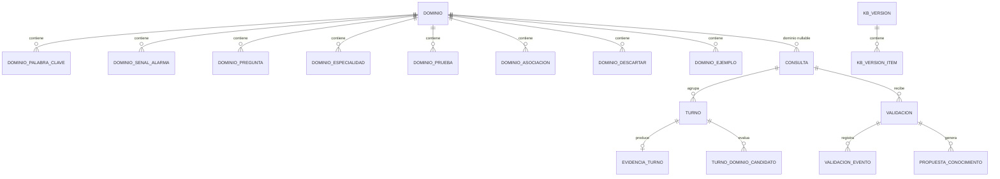

# Revisión clínica posterior y base de conocimiento relacional de MIDI

* **Author:** Juanxrpana
* **Status:** Draft
* **Date:** 2026-11-26

--------------------------------------------------------------------------------

## Overview

MIDI es el componente FastAPI que orienta al paciente hacia una especialidad del Centro de Especialidades Médicas Jehová Rafa. Hoy recomienda, pero no tiene un circuito formal para revisar la calidad de esa recomendación ni para convertir una corrección médica en conocimiento aprobado. La base de conocimiento clínica vive en archivos JSON, sin claves foráneas, y el aprendizaje se escribe automáticamente en cada consulta.

Este diseño añade tres piezas: una base de conocimiento relacional con `dominio` como raíz y **tablas separadas por tipo** (palabras, señales, preguntas, especialidades, pruebas, asociaciones, descartes y ejemplos); una validación posterior y opcional del especialista sobre la ficha y la respuesta final; y un índice determinista de confianza que marca los casos dudosos o multi-dominio para revisión. La validación no bloquea la recomendación: el paciente sigue siendo recomendado, no obligado a agendar. La cola de validación vive en el sistema PHP existente; FastAPI expone los endpoints y también aplica las validaciones de esquema, catálogo y confianza. El super usuario asume los casos que el especialista no valide.

**No se usa JSON como fuente de conocimiento en runtime.** `knowledge/dominios.json` y `knowledge/aprendido.json` son una entrada de migración de una sola vez; después de sembrar la base se eliminan como fuente operativa. Las columnas operativas `estado_json`, `datos_json`, `embedding` y `json_respuesta` se conservan como instantáneas opacas en la fase 1 y se normalizan en la fase 4.

## The Problem

El sistema actual no puede demostrar qué pasó en una consulta concreta. `session_id` se reutiliza para varias consultas, `mensajes` no tiene `consulta_id` ni `turno_id`, `agregar_mensaje` no devuelve el identificador del mensaje y `auditoria` no se enlaza con el mensaje ni con la ficha. La ficha que recibe el LLM se construye en memoria y no se guarda. Por eso una corrección del doctor no se puede unir de forma fiable con la ficha, la respuesta, el mensaje y la auditoría exactos.

El conocimiento clínico está en JSON. `dominios.json` y `aprendido.json` se leen y se fusionan en memoria; no hay claves foráneas, no hay versión de conocimiento y no hay un registro de quién cambió qué. El aprendizaje automático guarda la frase del usuario en cada detección de dominio y `POST /conocimiento` escribe ejemplos y palabras de inmediato. Ninguna de esas rutas pasa por aprobación.

La detección de dominio devuelve la primera coincidencia por subcadena o el mejor ejemplo por similitud, sin puntajes, sin top-k y sin margen entre candidatos. `hay_alarma` usa la misma lógica. Una frase como «no tengo fiebre» coincide con `fiebre`; «sin dolor de pecho» coincide con `pecho`; «no tengo dificultad para respirar» puede disparar una alarma. No existe un índice que distinga un caso claro de uno ambiguo.

La base actual tiene 10 sesiones, 90 mensajes, 45 auditorías y 1 memoria. De las 45 auditorías, 30 no tienen dominio porque el flujo general no lo asigna. Hay 4 dominios, 19 preguntas, 39 palabras clave curadas que se reducen a 29 al normalizar, 31 señales crudas que se reducen a 25, y 4 ejemplos aprendidos sin fecha ni estado. Cualquier migración que ignore esos datos produce una base incompleta o una detección distinta.

La validación médica tampoco tiene superficie. No hay cola, no hay rol verificado, no hay estados, no hay evidencia reproducible y no hay un responsable cuando el especialista no revisa. La API solo exige una clave compartida y confía en los headers de rol que envía PHP.

## Goals

* **Mover el conocimiento clínico a SQLite relacional por tipo.** `dominio` es la raíz; cada lista vive en su propia tabla (`dominio_palabra_clave`, `dominio_senal_alarma`, `dominio_pregunta`, `dominio_especialidad`, `dominio_prueba`, `dominio_asociacion`, `dominio_descartar`, `dominio_ejemplo`), con FK a `dominio` y `PRAGMA foreign_keys=ON` en todas las conexiones.
* **Eliminar JSON como fuente de verdad.** `dominios.json` y `aprendido.json` se importan una sola vez y se retiran del runtime; la aplicación lee de las tablas.
* **Dar identidad a la consulta y al turno.** Cada orientación final tiene `consulta_id`, `turno_id` y `mensaje_id`; la ficha, la respuesta, la auditoría y la validación se enlazan al mismo turno.
* **Guardar evidencia revisable sin duplicar la conversación.** Se guarda la respuesta final, un resumen estructurado de la ficha, hashes, versiones de KB, prompt, modelo y catálogo.
* **Producir un índice de confianza explicable.** Se guardan los componentes del puntaje, el top-k de dominios candidatos y las versiones del detector y de la alarma. La confianza **no es compuerta en la fase 1**: solo marca revisión y no cambia la respuesta.
* **Permitir validación posterior y opcional.** El especialista de la especialidad es el revisor natural de la fase 2; en la fase 1 solo el super usuario (`id_rol` de administración) revisa. Si no valida, el super usuario toma el caso. La cola y la pantalla viven en PHP.
* **Gobernar el aprendizaje.** Las correcciones y las propuestas de palabras o preguntas quedan pendientes; la publicación requiere aprobación de un actor distinto del proponente y deja registro de autor, motivo, origen y versión.
* **Migrar sin perder datos.** La migración conserva sesiones, mensajes, auditorías y memoria; reporta los 39 términos convertidos en 29 + 10 alias y las 31 señales en 25 + 6 alias, y conserva los conteos de `docs/03`.
* **Hacer visible la operación.** Hay salud, pocas métricas accionables, registro de acceso a fichas y una cola con estados, edad y responsable.

Criterios medibles:

* Toda conexión de escritura tiene `foreign_keys=1` y `foreign_key_check` devuelve cero violaciones.
* La migración conserva los conteos actuales y falla de forma visible si la base queda sin dominios o sin preguntas.
* Toda orientación final **posterior a la migración** tiene consulta, turno, resumen de evidencia, confianza explicable y estado de revisión. Las 45 filas históricas quedan marcadas como `legacy` y no entran en la cola.
* Ninguna propuesta no aprobada cambia `detectar_dominio` ni `hay_alarma`.
* La alarma no se dispara por una coincidencia solo negada; el set dorado de alarma pasa al 100%.
* La cola permite al super usuario ver pendientes, filtrar, tomar un caso y decidir, con registro de quién lo vio.
* Cada evidencia resuelve la `kb_version` exacta usada en el turno.

## Non-Goals

* Obligar al paciente a agendar o bloquear la recomendación.
* Validar antes de enviar la respuesta en esta fase.
* Permitir que un doctor intervenga en vivo dentro del chat.
* Validar cada pregunta, el dominio o el razonamiento por parte del doctor.
* Reemplazar `mensajes`, `sesiones`, `memorias` o `auditoria`.
* Aprender automáticamente de la propia salida o publicar sin aprobación.
* Diagnosticar, prescribir o recomendar tratamientos y dosis.
* Normalizar `estado_json`, `datos_json`, `embedding` y `json_respuesta` antes de la fase 4.
* Construir la cola de validación en FastAPI; la interfaz vive en PHP. FastAPI sí valida esquema, catálogo y confianza.
* Escalar a múltiples workers en esta fase.
* Introducir un tercer mecanismo de autenticación si el JWT/HS256 y la sesión PHP ya existen.

## Technical Plan (Architecture)

### 1. Vista general y fases

La solución separa tres planos:

- **Conocimiento:** SQLite relacional con `dominio` como raíz y una tabla por tipo.
- **Operación:** sesiones, consultas, turnos, mensajes, evidencia y auditoría. Las tablas actuales se conservan.
- **Revisión:** validaciones y propuestas de aprendizaje, con cola en PHP y endpoints en FastAPI.

Fases acordadas (normalizadas para reducir el big-bang):

| Fase | Entrega | Gate de salida |
|---|---|---|
| **0** | Motor compartido de evidencia (límites de palabra, negación, polaridad) para dominio **y** alarma; set dorado. | Alarma no dispara con negaciones; detección sin cambios en el set dorado. |
| **1** | KB por tipo + identidad `consulta`/`turno` + migración/seed. Sin cola, sin scoring, sin HMAC. | `foreign_key_check` en cero; conteos y detección idénticos. |
| **2** | Evidencia por turno final + `conectar()`/unit-of-work + outbox de auditoría + retención. | Toda orientación final post-migración tiene evidencia; fallo de auditoría no tumba el turno. |
| **3** | Cola de revisión, roles, propuestas, cuatro ojos, expiración/escalado. | Dos revisores no se pisan; el rol correcto decide; el proponente no autoaprueba. |
| **4** | Confianza/calibración/muestreo + normalización de columnas operativas. | Umbrales con datos; columnas JSON una por una con contrato y pruebas. |

### 2. Modelo de datos relacional

#### 2.1 Conocimiento (tablas por tipo)

Tabla raíz:

| Tabla | Columnas principales | Reglas |
|---|---|---|
| `dominio` | `id`, `clave`, `nombre`, `min_preguntas`, `max_preguntas`, `activo`, `orden`, `actualizado_en` | `clave` única e inmutable; borrado lógico `activo=0`; `CHECK` de mínimos. |

Una tabla por lista, todas con FK a `dominio` y `ON DELETE RESTRICT`:

| Tabla | Columnas principales | Reglas |
|---|---|---|
| `dominio_palabra_clave` | `id`, `dominio_id`, `valor`, `valor_normalizado`, `alias_de`, `origen`, `estado`, `orden`, `creado_en`, `actualizado_en` | Índice único parcial `(dominio_id, valor_normalizado) WHERE alias_de IS NULL`; `UNIQUE(alias_de, valor)` para alias; `alias_de` FK a la misma tabla. |
| `dominio_senal_alarma` | `id`, `dominio_id`, `valor`, `valor_normalizado`, `origen`, `estado`, `orden` | `UNIQUE(dominio_id, valor_normalizado)`. |
| `dominio_pregunta` | `id`, `dominio_id`, `clave`, `texto`, `orden`, `estado`, `origen` | `UNIQUE(dominio_id, clave)`; solo `estado='aprobado'` se formula. |
| `dominio_especialidad` | `id`, `dominio_id`, `nombre`, `catalogo_id` nullable, `orden` | `UNIQUE(dominio_id, nombre)`; `catalogo_id` se llena solo si el catálogo está disponible. |
| `dominio_prueba` | `id`, `dominio_id`, `valor`, `orden` | `UNIQUE(dominio_id, valor)`. |
| `dominio_asociacion` | `id`, `dominio_id`, `valor`, `orden` | `UNIQUE(dominio_id, valor)`. |
| `dominio_descartar` | `id`, `dominio_id`, `valor`, `orden` | `UNIQUE(dominio_id, valor)`. |
| `dominio_ejemplo` | `id`, `dominio_id`, `valor`, `valor_normalizado`, `origen`, `estado`, `creado_en` | `UNIQUE(dominio_id, valor_normalizado)`. |

Reglas transversales:

- `origen`: `curada`, `aprendida`, `correccion_medica`, `auto_legacy`.
- `estado`: `aprobado`, `pendiente`, `rechazado`; solo `aprobado` y `activo=1` participan en detección, alarma, preguntas y ficha.
- `valor_normalizado` se calcula con `ai/cuestionario._normalizar`; `normalizer_version` se guarda en `kb_version`.
- Las 31 señales crudas se siembran como 25 únicas + 6 alias; las 39 palabras como 29 canónicas + 10 alias. Un alias nunca es regla de detección.
- El catálogo no se replica: se guarda `catalogo_id`/`nombre` usados en `evidencia_turno`. `catalogo_especialidad` es una caché mínima opcional, no una fuente de verdad.

Versionado:

| Tabla | Columnas | Regla |
|---|---|---|
| `kb_version` | `id`, `version`, `hash`, `normalizer_version`, `descripcion`, `autor`, `activa`, `creado_en` | Una fila por publicación; `activa=1` apunta a la versión vigente. |
| `kb_version_item` | `id`, `kb_version_id`, `tipo`, `elemento_id`, `dominio_id`, `clave`, `valor`, `valor_normalizado`, `estado`, `alias_de` | Snapshot inmutable del set de conocimiento; `evidencia_turno.kb_version_id` resuelve la versión exacta. Revertir = activar una versión anterior. |

#### 2.2 Operación y evidencia

| Tabla | Columnas principales | Reglas |
|---|---|---|
| `consulta` | `id`, `session_id` nullable, `id_usuario`, `id_paciente`, `flujo`, `dominio_id`, `estado`, `iniciada_en`, `cerrada_en` | `flujo` en `cuestionario`, `general`, `emergencia`, `otro`; `session_id` FK `ON DELETE SET NULL`; una consulta abierta por sesión (índice parcial). |
| `turno` | `id`, `consulta_id`, `seq`, `peticion_id`, `tipo_respuesta`, `origen_respuesta`, `degradado`, `creado_en` | FK a `consulta`; `UNIQUE(consulta_id, seq)`; `UNIQUE(peticion_id)` para idempotencia; `origen_respuesta` en `llm`, `regla`, `fallback`. |
| `evidencia_turno` | `id`, `turno_id`, `mensaje_usuario_id`, `mensaje_asistente_id`, `resumen_ficha`, `ficha_hash`, `respuesta_final`, `respuesta_hash`, `kb_version_id`, `prompt_version`, `prompt_hash`, `modelo`, `catalogo_id`, `catalogo_nombre`, `scoring_version`, `detector_version`, `alarm_version`, `confianza_total`, `revision_requerida`, `motivo_revision`, `creado_en` | FK a `turno`; `UNIQUE(turno_id)`; se escribe en el turno final. |
| `evidencia_componente` | `id`, `evidencia_turno_id`, `nombre`, `valor`, `peso` | Componentes del score sin JSON. |
| `turno_dominio_candidato` | `id`, `turno_id`, `dominio_id`, `rank`, `score`, `termino`, `polaridad`, `fuente` | FK a `turno` y `dominio`; `UNIQUE(turno_id, rank)`. |
| `validacion` | `id`, `consulta_id`, `evidencia_turno_id`, `estado`, `asignado_a`, `tomado_en`, `expira_en`, `version`, `dominio_original_id`, `dominio_corregido_id`, `especialidad_original_id`, `especialidad_corregida_id`, `motivo_codigo`, `comentario`, `decision`, `creado_en`, `actualizado_en` | Caso mutable con claim atómico; estados `pendiente`, `asignada`, `vista`, `validada`, `corregida`, `descartada`, `expirada`. |
| `validacion_evento` | `id`, `validacion_id`, `estado`, `actor_id`, `detalle`, `creado_en` | Append-only; historial del caso. |
| `propuesta_conocimiento` | `id`, `validacion_id`, `dominio_id`, `tipo`, `clave`, `valor`, `valor_normalizado`, `capa_error`, `estado`, `generado_por`, `modelo`, `creado_en`, `aprobado_por`, `aprobado_en`, `aplicado_en`, `elemento_id` | `capa_error` con `CHECK`; `dominio_id` nullable solo para propuesta de dominio nuevo (ver §6). |
| `acceso_caso` | `id`, `validacion_id`, `usuario_id`, `rol`, `accion`, `creado_en` | Registra lectura y decisión; la lectura se hace con `POST /validaciones/{id}/visto`, no con un GET. |
| `schema_migrations` | `version` PK, `checksum`, `aplicada_en` | Control de migraciones. |

Tablas existentes:

- `mensajes` recibe `consulta_id` y `turno_id` nullable (FK `ON DELETE SET NULL`). `agregar_mensaje` devuelve `lastrowid`.
- `auditoria` recibe `consulta_id`, `turno_id`, `evidencia_turno_id`, `resultado` (`ok`, `fallback`, `error`) y `error_code`. La escritura va por outbox para no tumbar el turno.
- `sesiones` y `memorias` no cambian en la fase 1.
- `mensajes` y `auditoria` no llevan FK dura a las tablas nuevas; sus columnas son nullable para no romper `DELETE /sesiones` ni la retención.
- `consulta.session_id` es FK nullable `ON DELETE SET NULL`: borrar la sesión no borra el caso.

Índices mínimos: `evidencia_turno(revision_requerida, creado_en)`, `validacion(estado, creado_en)`, `turno(consulta_id)`, `mensajes(consulta_id, turno_id)`, `auditoria(consulta_id, turno_id)`, parcial `consulta(session_id) WHERE estado='abierta'`.

### 3. Flujo de una consulta

1. PHP llama a `POST /orientar` con `consulta`, `session_id` y `peticion_id` (UUID).
2. FastAPI abre o recupera la `consulta` abierta de la sesión. Si la sesión ya cerró una consulta, crea otra. Crea un `turno` con `seq` en la misma transacción; si `peticion_id` ya existe, devuelve el turno existente.
3. Registra el mensaje del usuario y lo enlaza al `turno`.
4. Detecta candidatos de dominio. Si hay dominio, aplica el cuestionario. Si no, usa el flujo general.
5. Al finalizar, construye el resumen de la ficha, llama al proveedor, valida esquema/catálogo y calcula la confianza (provisional, no compuerta).
6. Guarda `evidencia_turno`, `evidencia_componente`, `turno_dominio_candidato`, el mensaje del asistente y la auditoría (outbox) en una unidad de trabajo.
7. Marca `revision_requerida` según la matriz de §4.
8. Devuelve `RespuestaOrientacion` a PHP. La respuesta no cambia por la confianza.
9. La cola PHP consulta `GET /validaciones` y muestra el resumen de la ficha y la respuesta final.
10. El super usuario toma el caso y decide. La decisión se guarda como evento; si hay corrección, se crean propuestas pendientes.

**Cierre de consulta:** la consulta se cierra con `orientacion`, `emergencia`, `derivar`, `catalogo`, `datos` y `navegacion`; `aclaracion` no la cierra. `consulta.estado` se deriva de `estado_json`/`tipo_respuesta` con una tabla de mapeo única: `abierta`, `cerrada`, `expirada`, `legacy`. El siguiente mensaje de la misma sesión abre una consulta nueva. Los tipos `datos`/`navegacion` se registran como `no_aplica` con motivo, no como evidencia clínica.

### 4. Detección, alarma y confianza

Se sustituye `detectar_dominio` por dos funciones:

- `detectar_candidatos(texto, dominios)` devuelve una lista ordenada de candidatos con `dominio_id`, `score`, `rank`, `termino`, `polaridad` y `fuente`.
- `detectar_dominio(texto)` se conserva como envoltorio para el código existente y devuelve el primer candidato que supera el umbral de **elegibilidad**; si no hay, `None`.

**Un solo motor de evidencia** (`detectar_evidencia`) aplica límites de palabra, ventana de negación y polaridad a **dominio y alarma**. `hay_alarma` se migra a ese motor; una coincidencia solo negada no dispara alarma. La alarma tiene umbral y recall propios, versión `alarm_version` y set dorado con «no tengo fiebre», «sin dolor de pecho», «no tengo dificultad para respirar», doble negación y un positivo real. La decisión, el término y la polaridad se guardan en evidencia/auditoría.

La **elegibilidad de routing** y el **score de revisión** son distintos: `detectar_dominio` usa una regla de elegibilidad versionada (`deteccion_version`); `revision_requerida` usa `confianza_total` y `margen_top1_top2`. La fórmula y los pesos viven en un artefacto versionado (`scoring_version`) y son provisionales.

Componentes persistidos en `evidencia_componente`: `coincidencia_keyword`, `similitud_ejemplo`, `margen_top1_top2`, `num_candidatos`, `preguntas_respondidas`, `penalizacion_negacion`.

**Matriz de revisión:**

| Tipo de respuesta | Evidencia | Revisión | Motivo |
|---|---|---|---|
| `orientacion` con ficha | Completa | Clínica si confianza < umbral, margen < mínimo o multi-dominio; muestreo de alta confianza | Calidad de la orientación |
| `catalogo` / `derivar` | Resumen + respuesta | Operativa (`catalogo no disponible`, fallback) o `no_aplica` con motivo | Degradación, no clínica |
| `emergencia` | Resumen + respuesta | `no_aplica` con motivo; muestra pequeña para auditoría | Seguridad |
| `general` | Resumen + respuesta | `no_aplica` o muestra; sin ficha de cuestionario | Cobertura |
| `datos` / `navegacion` | Mínima | `no_aplica` | No clínico |

La confianza **no es compuerta** en la fase 1. Se guarda como señal; el umbral solo decide si entra a la cola. Los umbrales iniciales `0.60` y `0.15` son provisionales, con fecha de revisión y muestra de control del 5–10% de casos de alta confianza.

### 5. Evidencia y validación

`evidencia_turno` guarda: `resumen_ficha` (motivo, respuestas, antecedentes, dominio, especialidad, resultado), `ficha_hash`, `respuesta_final`, `respuesta_hash`, `kb_version_id`, `prompt_version`/`prompt_hash`, `modelo`, `catalogo_id`/`catalogo_nombre`, `scoring_version`, `detector_version`, `alarm_version`, `confianza_total` y `revision_requerida`. **No se guarda el prompt crudo**; el detalle sigue en `mensajes`. `resumen_ficha` es una **copia derivada de evidencia**, no una segunda historia clínica, con retención en §8.

#### 5.1 Cola en PHP

- `ControllerValidaciones` con `cola()`, `detalle()`, `tomar()`, `decidir()`, `propuestas()` y `visto()`.
- Vistas `vistaValidaciones/cola.php` y `detalle.php`; enlace en el menú de administración.
- La sesión PHP verifica el rol de super usuario (`id_rol` de administración) con `ModeloPermisos`; el rol `doctor` queda para la fase 2.
- La cola muestra resumen, banda de confianza, edad, especialidad, dominio y estado. No muestra la conversación completa.
- `tomar()` es un `UPDATE ... WHERE estado='pendiente'` o reasignación si `expira_en` venció. Un `409` devuelve dueño y `expira_en`. `expira_en` dispara liberación/reasignación automática al super usuario.
- El acceso a la ficha se registra con `POST /validaciones/{id}/visto`; un GET no escribe.

#### 5.2 Endpoints FastAPI

| Endpoint | Uso |
|---|---|
| `GET /validaciones` | Lista filtrable por estado, especialidad, dominio, confianza y fecha; paginación por cursor `(creado_en, id)`. |
| `GET /validaciones/{id}` | Detalle con resumen, respuesta final, candidatos y eventos; sin escritura. |
| `POST /validaciones/{id}/tomar` | Reclama el caso; `409` con dueño y `expira_en` si ya está tomado. |
| `POST /validaciones/{id}/visto` | Registra `acceso_caso`. |
| `POST /validaciones/{id}/decision` | Aprueba, corrige o descarta; exige `motivo_codigo` al corregir/descartar; idempotencia por `Idempotency-Key` con tabla `idempotencia`. |
| `GET /propuestas` | Propuestas pendientes o rechazadas. |
| `POST /propuestas/{id}/aprobar` | Publica en la tabla por tipo y crea `kb_version`; exige aprobador distinto del proponente. |
| `POST /propuestas/{id}/rechazar` | Cierra la propuesta sin tocar la KB. |
| `GET /salud` | Esquema, KB, FKs, catálogo, auditoría y cola. |

**Autenticación:** se reutiliza la API key compartida + la sesión/rol verificado por PHP (o el JWT HS256 existente con `JWT_SECRET`). No se introduce `VALIDACION_HMAC_KEY` salvo que el threat model lo exija; si se usa un token, se firma con HS256 y claims `usuario_id`, `id_rol`, `especialidad_id`, `exp`, `nonce`, con TTL corto, rotación y anti-replay. FastAPI valida esquema, catálogo y confianza; la decisión humana y la cola viven en PHP.

### 6. Aprendizaje gobernado

- `main.py` deja de llamar a `aprender_ejemplo` en cada detección.
- `POST /conocimiento` deja de escribir directo; crea una `propuesta_conocimiento` pendiente y devuelve `{ok, dominio, pendiente}` (compatibilidad de respuesta).
- Una corrección con `motivo_codigo` de dominio o pregunta puede generar propuestas. El LLM se invoca solo cuando el revisor pide generar propuestas, con límite de 3 palabras y 2 preguntas; el resultado se guarda como pendiente.
- El LLM no publica. La aprobación es una transacción: verifica estado pendiente, dominio activo, duplicado normalizado en la tabla por tipo; inserta o actualiza; marca la propuesta como aplicada; crea `kb_version`; registra `acceso_caso` y `validacion_evento`.
- **Cuatro ojos:** `aprobado_por` debe ser distinto de `generado_por`; si se permite la autoaprobación, se declara como riesgo aceptado.
- **Filtro único:** `cargar_conocimiento_activo()` lee `dominio.activo=1`, elemento `activo=1`, `estado='aprobado'` y el tipo correspondiente. Se usa en detección, alarma, preguntas y ficha. El caché se invalida al cambiar `kb_version`.
- Las preguntas pendientes no se formulan. Los alias no son reglas.
- Propuestas de dominio nuevo: en fase 1 se rechazan o se guardan en una tabla `propuesta_dominio` separada con `clave`, `nombre`, `min_preguntas`, `max_preguntas`, `orden`; no se aplican hasta la fase 3.
- `motivo_codigo`: `especialidad_incorrecta`, `dominio_incorrecto`, `pregunta_faltante`, `ficha_incompleta`, `redaccion`, `datos_paciente`, `otro`. `capa_error` se guarda con `CHECK`.

### 7. Migración y seed

1. Copia de seguridad de `storage/midi.db` con la API de SQLite o `VACUUM INTO`, con checkpoint WAL y servicio detenido.
2. `schema_migrations` con runner por archivo, checksum, transacción por migración e idempotencia; baseline de la base existente.
3. `storage/db.py:conectar()` con `PRAGMA foreign_keys=ON`, `busy_timeout` y WAL. Todas las conexiones usan la fábrica.
4. Creación de tablas nuevas. `mensajes` y `auditoria` solo reciben columnas nullable; no se reconstruyen.
5. Seed desde `dominios.json` (una sola vez):
   - 4 dominios, 19 preguntas, 31 señales → 25 únicas + 6 alias, 11 pruebas, 12 asociaciones, 12 descartes, 4 ejemplos.
   - 39 palabras → 29 canónicas + 10 alias.
   - 5 relaciones de especialidad (2 nombres distintos: `CARDIOLOGIA`, `CONSULTA GENERAL`); el resto de nombres del catálogo se resuelve en runtime.
6. Seed de `aprendido.json`: 4 ejemplos pendientes, sin efecto en detección.
7. `kb_version` con hash del seed y `normalizer_version`.
8. `foreign_key_check`, conteos y comparación de detección/alarma contra el set dorado.
9. Arranque fail-closed si `dominio` tiene cero filas, falta `kb_version` o falta una pregunta mínima.
10. Retirar `dominios.json` y `aprendido.json` del runtime; conservarlos solo como archivo de migración hasta validar el seed en una base vacía.

La migración no inventa consultas para las 90 filas históricas: `mensajes` y `auditoria` quedan con `consulta_id`/`turno_id` nulos y se marcan `legacy` (`consulta_id IS NULL`). No entran en la cola.

`docs/03-base-de-conocimiento-relacional.md` se declara **superado** por este draft; se adopta su modelo por tipo y se mapean sus conteos y su retención. Si se prefiere, se actualiza `docs/03` en el mismo PR.

Rollback: restaurar la copia de `midi.db`, revertir el código y conservar el seed hasta que esté probado en una base vacía.

### 8. Observabilidad, seguridad y retención

- `/salud` informa `schema_version`, `kb_version`, `foreign_keys`, `foreign_key_check`, edad del catálogo, última auditoría, cola pendiente y edad de la cola.
- Logs estructurados con `consulta_id`, `turno_id`, `evento`, `resultado`, `latencia_ms`; **sin texto clínico crudo**. Se corrige `main.py` para no loguear la consulta cruda.
- Métricas mínimas: backlog/edad de cola, fallback, violaciones de migración, turnos finales sin evidencia, correcciones por motivo. Se añade una métrica cuando una decisión dependa de ella.
- `acceso_caso` registra lectura y decisión de fichas.
- Retención por tabla: sesiones 90 días; auditoría 1 año; evidencia y validaciones 1 año desde el cierre del caso; `resumen_ficha` se anonimiza al borrar la sesión, salvo copia redactada para disputa autorizada; `mensajes` y `memorias` mantienen su tratamiento actual. La redacción es un evento auditable.
- Acceso: `GET /sesiones/{id}`, `GET /auditoria` y `GET /validaciones` exigen rol autorizado, no solo la API key. El límite servicio-a-servicio se documenta.
- La API key compartida sigue siendo transporte servicio a servicio; la identidad del revisor se toma del JWT/sesión PHP verificado.

### 9. Supuestos técnicos para revisión

- El JWT HS256 existente o la sesión PHP verificada bastan para identificar al revisor; si se añade token propio, se documenta custodia, rotación y anti-replay.
- El umbral inicial `0.60` y el margen `0.15` son provisionales y **no son compuerta** en la fase 1.
- La cola clínica revisa `orientacion` con ficha; `catalogo`/`derivar` van a revisión operativa o `no_aplica` con motivo; `emergencia`/`general`/`datos`/`navegacion` se registran como `no_aplica` o muestra.
- Los históricos no se reetiquetan con una consulta sintética.
- La fase 4 normaliza las columnas operativas una por una, con contratos y pruebas propias.

--------------------------------------------------------------------------------

## Alternatives Considered

| Alternativa | Decisión y por qué |
|---|---|
| JSON (`dominios.json` + `aprendido.json`) como fuente de verdad | **Rechazada.** No se usa JSON en runtime: sin FK, sin versión, sin autoría ni rollback. Solo es entrada de migración de una sola vez y se retira después del seed. |
| Una tabla polimórfica `dominio_elemento` con `tipo` | **Rechazada.** El profesor pidió separar los datos del dominio en tablas aparte para normalizar más la KB; cada lista tiene su tabla, su `UNIQUE` y su `FK`. |
| Tablas por tipo (`dominio_palabra_clave`, `dominio_senal_alarma`, ...) | **Aceptada.** Es la indicación del profesor; permite constraints por tipo y evita columnas nulas. Coste: más DDL y un loader que consulta cada tabla. |
| Cola de validación en FastAPI | **Rechazada.** Duplica sesión, CSRF, roles y menú que PHP ya tiene. FastAPI sí aplica validaciones de esquema, catálogo y confianza; la cola humana vive en PHP. |
| Validación médica antes de responder | **Rechazada.** Bloquea la recomendación y convierte al revisor en cuello de botella; la revisión es opcional, posterior al chat y no bloquea el flujo. |
| Normalizar `estado_json`, `datos_json`, `embedding` y `json_respuesta` en la fase 1 | **Rechazada para fase 1.** Se normalizan una por una en la fase 4, con contratos y pruebas; adelantarlo reescribe `main.py` y cuatro repositorios en el mismo incremento. |
| Guardar la ficha completa en vez de un resumen | **Rechazada.** Más PII durable y retención sin resolver; se guarda un resumen estructurado + hash y se registra la limitación como riesgo aceptado. |
| Reutilizar el JWT HS256/sesión PHP en vez de un `VALIDACION_HMAC_KEY` nuevo | **Aceptada.** Evita un tercer mecanismo de auth; si se necesita token propio, se firma con HS256 y claims verificables. |
| Fases 0–4 en vez de una "fase 1" big-bang | **Aceptada.** Reduce el riesgo y permite gates de salida verificables. |

## Risks & Mitigations

| Riesgo | Disparador | Impacto | Mitigación | Dueño / métrica |
|---|---|---|---|---|
| Falso positivo de emergencia por negación | `hay_alarma` por subcadena | Alarma innecesaria; ansiedad y coste | Motor compartido con límites de palabra, negación y polaridad; set dorado; umbral/recall propios | Alarma: FP/TP |
| Confianza mal calibrada | Umbrales 0.60/0.15 sin datos | Falsa assurance o cola vacía | Muestra de control de alta confianza; fecha de revisión; `scoring_version` | Calibración: errores por banda |
| Fallo al escribir evidencia | SQLite bloqueada o error | Turno sin evidencia o error al paciente | Unit-of-work + política durable; outbox de auditoría; reintento idempotente | Turnos sin evidencia |
| Contención de escritores SQLite | Peticiones concurrentes | `database is locked` y latencia | `busy_timeout`, WAL, una conexión por unidad de trabajo; un worker en fase 1 | Errores de lock |
| Migración/seed parcial | Corte a mitad del seed | KB incompleta o detección distinta | Transacción por migración, `foreign_key_check`, fail-closed por dominios/preguntas faltantes, rollback probado | Migración: checksum/estado |
| Compromiso o replay del token de revisor | Secreto filtrado o token robado | Decisiones no autorizadas | TTL corto, nonce/replay cache, rotación, TLS, CSRF, audience/método; o JWT existente | Auth: 401/409 por replay |
| PII en evidencia/auditoría | Texto clínico persistido | Exposición y retención indefinida | Retención por tabla, redacción/anonimización, acceso auditado, no prompt crudo | Retención: filas vencidas |
| PHP no disponible | Caída del sistema PHP | Sin catálogo, sin cola, sin datos de paciente | Degradación explícita: catálogo cacheado con edad, `catalogo`/`derivar`, cola en pausa | Salud: edad de catálogo |
| Coste/límite del LLM | Cuota agotada o 429 | Respuesta degradada | Fallback determinista, timeout por modelo, límite por caso/día, métrica de fallback | LLM: 429/fallback |
| Pérdida de `storage/midi.db` | Borrado o disco | Pérdida de sesiones/evidencia local | Backup con API de SQLite/`VACUUM INTO`, checkpoint WAL, restore probado; la KB se re-siembra | Backup: último OK |
| La revisión posterior no protege la consulta actual | Revisión solo post-hoc | El paciente ya recibió la respuesta | Riesgo aceptado explícito; la validación es control de calidad, no compuerta | Aceptado |
| Confusión de roles en fase 1 | Especialista vs super usuario | Autorización equivocada | Fase 1 solo super usuario (`id_rol` existente); especialista en fase 2; matriz y tests | Auth: rol correcto |

--------------------------------------------------------------------------------

## Detailed Implementation Plan

### Alcance y límites

* **Repo A (FastAPI):** `C:\Users\Edouard\Documents\universidad\proyecto\AI-T4`.
* **Repo B (PHP):** `C:\xampp\htdocs\Sistema-del--CEM--JEHOVA-RAFA`.
* **Dependencias nuevas:** ninguna. `aiosqlite` ya está en `requirements.txt`.
* **Allowlist de escritura:** solo los archivos listados abajo. No se tocan `knowledge/*.json` en runtime ni se añaden dependencias.
* **Regla de cero decisiones:** los nombres, estados, umbrales y rutas quedan fijados aquí; el implementador no elige.

### Fase 0 — Motor de evidencia y alarma (sin esquema)

#### 1. `ai/evidencia.py` (Create)
* **Type / Scope:** Python module.
* **Proposed Changes:** implementar:
  * `normalizar(texto: str) -> str` (NFD, minúsculas, sin acentos; misma salida que `ai/cuestionario._normalizar`).
  * `tokens(texto: str) -> set[str]` (longitud ≥ 4, sin stopwords de `ai/cuestionario._VACIAS`).
  * `detectar_evidencia(texto: str, terminos: Iterable[str], ventana: int = 3) -> list[dict]`; cada dict: `{"termino", "polaridad": "positiva"|"negativa", "offset", "ventana"}`.
  * `coincide(texto: str, terminos: Iterable[str]) -> bool` (alguna polaridad positiva).
  * `similitud(a: str, b: str) -> float` (Jaccard de tokens; umbral 0.60).
  * `hay_alarma(texto: str, terminos: Iterable[str]) -> bool` (usa `coincide`, no subcadena).

#### 2. `ai/cuestionario.py` (Modify)
* **Type / Scope:** Python module.
* **Proposed Changes:**
  * Importar `ai.evidencia` y eliminar la lógica local de `_tokens`/`_similitud`/negación.
  * `detectar_candidatos(texto: str, dominio: str, palabras: list[str], ejemplos: list[str]) -> list[dict]`; devuelve `dominio_id`/`score`/`rank`/`termino`/`polaridad`/`fuente`.
  * `detectar_dominio(texto: str) -> str | None` como envoltorio del primer candidato con `score >= elegibilidad` (regla positiva: al menos una coincidencia positiva o ejemplo ≥ 0.60).
  * `hay_alarma(texto: str, dominio: str) -> bool` delega en `evidencia.hay_alarma`.
  * Eliminar la llamada automática a `aprender_ejemplo`; esa ruta pasa a propuestas en Fase 3.

#### 3. `tests/test_evidencia.py` (Create)
* **Type / Scope:** pytest.
* **Proposed Changes:** casos: `«no tengo fiebre»` → polaridad negativa; `«sin dolor de pecho»` → negativa; `«tengo fiebre»` → positiva; doble negación; término dentro de frase positiva; acentos (`torácico`/`toracico`); `similitud` exacta.

#### 4. `tests/test_alarma.py` (Create)
* **Type / Scope:** pytest.
* **Proposed Changes:** `«no tengo dificultad para respirar»` → no alarma; `«sin dolor de pecho»` → no alarma; `«dolor de pecho opresivo»` → alarma; `«no tengo fiebre pero me falta el aire»` → alarma; set dorado de alarma al 100%.

**Gate de Fase 0:** `pytest tests/test_evidencia.py tests/test_alarma.py` verde; la detección del set dorado de dominio no cambia respecto a la base.

### Fase 1 — KB por tipo + identidad `consulta`/`turno`

#### 5. `storage/migrations/001_kb_por_tipo.sql` (Create)
* **Type / Scope:** SQLite migration.
* **Proposed Changes:** crear `schema_migrations`, `dominio`, `dominio_palabra_clave`, `dominio_senal_alarma`, `dominio_pregunta`, `dominio_especialidad`, `dominio_prueba`, `dominio_asociacion`, `dominio_descartar`, `dominio_ejemplo`, `kb_version`, `kb_version_item`.
  * Todas las tablas de lista con `dominio_id INTEGER NOT NULL REFERENCES dominio(id) ON DELETE RESTRICT`.
  * `dominio_palabra_clave`: `CREATE UNIQUE INDEX ux_palabra_canonica ON dominio_palabra_clave(dominio_id, valor_normalizado) WHERE alias_de IS NULL;` y `UNIQUE(alias_de, valor)`.
  * `dominio_senal_alarma`, `dominio_ejemplo`: `UNIQUE(dominio_id, valor_normalizado)`.
  * `dominio_pregunta`: `UNIQUE(dominio_id, clave)`.
  * `dominio_especialidad`, `dominio_prueba`, `dominio_asociacion`, `dominio_descartar`: `UNIQUE(dominio_id, valor)`.
  * `kb_version`: `activa INTEGER NOT NULL DEFAULT 0 CHECK (activa IN (0,1))`.
  * `kb_version_item`: FK a `kb_version`; snapshot `(tipo, elemento_id, dominio_id, clave, valor, valor_normalizado, estado, alias_de)`.

#### 6. `storage/migrations/002_identidad_consulta_turno.sql` (Create)
* **Type / Scope:** SQLite migration.
* **Proposed Changes:** crear `consulta`, `turno`, `evidencia_turno`, `evidencia_componente`, `turno_dominio_candidato`, `validacion`, `validacion_evento`, `propuesta_conocimiento`, `acceso_caso`, `idempotencia`.
  * `consulta.session_id TEXT NULL REFERENCES sesiones(session_id) ON DELETE SET NULL`.
  * `CREATE UNIQUE INDEX ux_consulta_abierta ON consulta(session_id) WHERE estado='abierta';`
  * `turno.peticion_id TEXT NOT NULL UNIQUE`; `UNIQUE(consulta_id, seq)`.
  * `evidencia_turno` con las columnas de §2.2; `UNIQUE(turno_id)`.
  * `validacion` con `estado` `CHECK` en `('pendiente','asignada','vista','validada','corregida','descartada','expirada')`, `asignado_a`, `tomado_en`, `expira_en`, `version`.
  * `idempotencia(clave TEXT, actor_id TEXT, endpoint TEXT, respuesta_hash TEXT, creado_en TEXT, UNIQUE(actor_id, endpoint, clave))`.
  * Añadir a `mensajes`: `consulta_id`, `turno_id` nullable; a `auditoria`: `consulta_id`, `turno_id`, `evidencia_turno_id`, `resultado`, `error_code`.

#### 7. `storage/db.py` (Modify)
* **Type / Scope:** Python module.
* **Proposed Changes:**
  * `async def conectar() -> aiosqlite.Connection`: `aiosqlite.connect(DB_PATH)`, `PRAGMA foreign_keys=ON`, `PRAGMA journal_mode=WAL`, `PRAGMA busy_timeout=5000`, `row_factory=aiosqlite.Row`.
  * `async def migrar() -> None`: lee `storage/migrations/*.sql` ordenados, valida `checksum`, ejecuta cada uno en transacción e inserta en `schema_migrations`; idempotente.
  * `async def init_db() -> None`: crea `schema_migrations` si falta y llama `migrar()`; fail-closed si `dominio` queda vacío o falta una pregunta mínima.
  * Todos los repositorios usan `conectar()`; se elimina `aiosqlite.connect(DB_PATH)` directo.

#### 8. `storage/conocimiento.py` (Create)
* **Type / Scope:** Python module.
* **Proposed Changes:**
  * `async def cargar_conocimiento_activo() -> dict` con una consulta por tabla: `dominio.activo=1`, `elemento.activo=1`, `elemento.estado='aprobado'`, `alias_de IS NULL` para detección; devuelve `{dominio: {palabras, senales, preguntas, especialidades, pruebas, asociaciones, descartes, ejemplos}}`.
  * `def invalidar_cache() -> None` y caché de módulo con `kb_version.activa`.
  * `async def publicar_version(descripcion, autor) -> int`: inserta `kb_version` + `kb_version_item` y marca la nueva como activa.
  * `async def revertir_version(version_id: int) -> None`: activa una versión anterior.

#### 9. `scripts/seed_kb.py` (Create)
* **Type / Scope:** one-shot migration script.
* **Proposed Changes:** lee `knowledge/dominios.json` y `knowledge/aprendido.json`; inserta 4 dominios, 19 preguntas, 39 palabras (29 canónicas + 10 alias), 31 señales (25 únicas + 6 alias), 11 pruebas, 12 asociaciones, 12 descartes, 4 ejemplos pendientes; resuelve `catalogo_id` por nombre normalizado si el catálogo está disponible; crea `kb_version` con hash y `normalizer_version`; no arranca si `foreign_key_check` falla. Tras el seed, los JSON quedan como archivo de migración y no se leen en runtime.

#### 10. `storage/sesiones.py` (Modify)
* **Type / Scope:** Python module.
* **Proposed Changes:**
  * `async def obtener_o_crear_consulta(session_id, id_usuario, peticion_id) -> dict`: recupera la consulta abierta; si no hay, crea `consulta` y `turno(seq=1)`; si `peticion_id` existe, devuelve el turno existente (idempotencia).
  * `async def crear_turno(consulta_id, peticion_id) -> dict`: `seq = COALESCE(MAX(seq),0)+1` dentro de la transacción.
  * `async def cerrar_consulta(consulta_id, estado) -> None`.
  * `agregar_mensaje` devuelve `lastrowid` y recibe `consulta_id`/`turno_id` opcionales.

#### 11. `main.py` (Modify)
* **Type / Scope:** FastAPI app.
* **Proposed Changes:**
  * `ConsultaIn` añade `peticion_id: str | None = None`; si falta, se genera un UUID y se loguea una advertencia (compatibilidad); PHP lo enviará siempre.
  * `/orientar` usa `obtener_o_crear_consulta`, `crear_turno`, unidad de trabajo y cierre por tipo (`orientacion`, `emergencia`, `derivar`, `catalogo`, `datos`, `navegacion`; `aclaracion` no cierra).
  * `ver_sesion`/`borrar_sesion` usan `conectar()`; `borrar_sesion` deja `consulta.session_id=NULL` por FK.

#### 12. `docs/03-base-de-conocimiento-relacional.md` (Modify)
* **Type / Scope:** documentation.
* **Proposed Changes:** añadir al inicio `> Superado por design_draft.md (2026-11-26). Se adopta el modelo por tipo; los conteos y la retención se conservan.` y una tabla de mapeo viejo→nuevo.

#### 13. `tests/test_migracion_kb.py` (Create)
* **Type / Scope:** pytest + SQLite temporal.
* **Proposed Changes:** crear base vacía, ejecutar migraciones + seed, assert `foreign_key_check == []`, conteos 4/19/39→29+10/31→25+6/11/12/12/4, detección del set dorado idéntica, `kb_version.activa=1`.

#### 14. `tests/test_identidad.py` (Create)
* **Type / Scope:** pytest.
* **Proposed Changes:** dos peticiones con el mismo `peticion_id` devuelven el mismo `turno`; dos mensajes en la misma sesión con consulta cerrada crean `consulta` nueva; `DELETE /sesiones` deja `consulta.session_id=NULL` y no borra el caso.

**Gate de Fase 1:** `pytest tests/test_migracion_kb.py tests/test_identidad.py` verde; `foreign_key_check` vacío; detección y conteos iguales al set dorado.

### Fase 2 — Evidencia, unit-of-work, outbox y retención

#### 15. `storage/evidencia.py` (Create)
* **Type / Scope:** Python module.
* **Proposed Changes:**
  * `async def guardar_evidencia(turno_id, mensaje_usuario_id, mensaje_asistente_id, resumen, ficha_hash, respuesta_final, respuesta_hash, kb_version_id, prompt_version, prompt_hash, modelo, catalogo_id, catalogo_nombre, scoring_version, detector_version, alarm_version, confianza_total, componentes: list[dict], revision_requerida, motivo_revision) -> int`.
  * Inserta `evidencia_turno` + `evidencia_componente` en la misma transacción.
  * `async def listar_por_turno(turno_id)`.

#### 16. `storage/auditoria.py` (Modify)
* **Type / Scope:** Python module.
* **Proposed Changes:** `registrar` escribe en `auditoria_outbox` dentro de la unidad de trabajo; `relay_auditoria()` mueve outbox→`auditoria` con `INSERT OR IGNORE` por `idempotency_key`; un fallo de relay se loguea y no tumba el turno.

#### 17. `storage/db.py` (Modify)
* **Type / Scope:** Python module.
* **Proposed Changes:** `@asynccontextmanager async def unidad_de_trabajo()` que abre `conectar()`, hace `BEGIN`, `yield db`, `COMMIT`, y `ROLLBACK` ante excepción. Añadir `auditoria_outbox` a `001`/`002` (migración `003_outbox.sql`).

#### 18. `main.py` (Modify)
* **Type / Scope:** FastAPI app.
* **Proposed Changes:**
  * En el turno final: construir evidencia, insertar `evidencia_turno` + `evidencia_componente`, mensaje del asistente, `auditoria_outbox` y `consulta.estado='cerrada'` en una sola `unidad_de_trabajo()`.
  * Si la escritura durable falla: `503` reintentable, sin llamar de nuevo al LLM; log con `consulta_id`/`turno_id`.
  * `GET /sesiones/{id}` y `GET /auditoria` exigen `X-Usuario-Id` con rol autorizado (super usuario o dueño del caso); si no, `403`.
  * No loguear `body.consulta` cruda; loguear `consulta_len` y `consulta_hash`.

#### 19. `storage/migrations/003_outbox.sql` (Create)
* **Type / Scope:** SQLite migration.
* **Proposed Changes:** `auditoria_outbox(id, idempotency_key UNIQUE, payload_json, creado_en, enviado_en)`; índice `enviado_en NULL`.

#### 20. `tests/test_evidencia.py` (Create)
* **Type / Scope:** pytest.
* **Proposed Changes:** un turno final produce exactamente una `evidencia_turno` con `respuesta_final`, componentes y `kb_version_id`; el GET de la cola renderiza la respuesta; `respuesta_hash` cambia si cambia la respuesta.

#### 21. `tests/test_transaccion.py` (Create)
* **Type / Scope:** pytest + fault injection.
* **Proposed Changes:** simular fallo en `auditoria_outbox` → la respuesta sigue y el relay reintenta; simular fallo en `evidencia_turno` → `503` y no se duplica el turno; `DELETE /sesiones` no borra evidencia ni deja FKs rotas.

**Gate de Fase 2:** `pytest tests/test_evidencia.py tests/test_transaccion.py` verde; 0 turnos finales sin evidencia en la base de prueba.

### Fase 3 — Cola de revisión, propuestas y roles

#### 22. `storage/validaciones.py` (Create)
* **Type / Scope:** Python module.
* **Proposed Changes:**
  * `async def listar(estado, especialidad, dominio, confianza, cursor, limite)` con cursor `(creado_en, id)`.
  * `async def detalle(id)`.
  * `async def tomar(id, actor_id)` → `UPDATE validacion SET estado='asignada', asignado_a=?, tomado_en=now, expira_en=now+48h, version=version+1 WHERE id=? AND (estado='pendiente' OR expira_en < now)`; si `rowcount=0`, `409` con dueño/expiración.
  * `async def decidir(id, actor_id, decision, motivo_codigo, comentario)`.
  * `async def visto(id, actor_id, rol)` inserta `acceso_caso`.
  * `async def liberar_expiradas()` para el watchdog.

#### 23. `storage/propuestas.py` (Create)
* **Type / Scope:** Python module.
* **Proposed Changes:** `crear`, `listar`, `aprobar` (transacción: verifica `estado='pendiente'`, dominio activo, duplicado en la tabla por tipo, `aprobado_por != generado_por`, inserta/actualiza, crea `kb_version`, marca aplicada), `rechazar`.

#### 24. `main.py` (Modify)
* **Type / Scope:** FastAPI app.
* **Proposed Changes:** añadir endpoints de §5.2; `POST /validaciones/{id}/visto` para acceso; `GET /validaciones/{id}` sin escritura; `POST /conocimiento` devuelve `{ok, dominio, pendiente}` y crea propuesta; `GET /salud`.

#### 25. `src/controllers/ControllerValidaciones.php` (Create)
* **Type / Scope:** PHP controller.
* **Proposed Changes:** `cola()`, `detalle($id)`, `tomar($id)`, `decidir($id)`, `propuestas()`, `visto($id)`; sesión + CSRF; rol super usuario (`$_SESSION['id_rol']` 10) verificado con `ModeloPermisos` módulo `Validaciones`; proxy a FastAPI con `X-API-Key`, `X-Usuario-Id`, `X-Usuario-Rol`, `X-Usuario-Nombre`; `409` recarga estado.

#### 26. `src/vistas/vistaValidaciones/cola.php` (Create)
* **Type / Scope:** PHP view.
* **Proposed Changes:** tabla con resumen, banda de confianza, edad, especialidad, dominio, estado, botón Tomar/Ver; sin conversación completa; enlace en el menú.

#### 27. `src/vistas/vistaValidaciones/detalle.php` (Create)
* **Type / Scope:** PHP view.
* **Proposed Changes:** ficha resumida, respuesta final, candidatos, historial de eventos, formulario de decisión con `motivo_codigo` obligatorio al corregir/descartar.

#### 28. `src/config/equivalencias.php` (Modify)
* **Type / Scope:** PHP config.
* **Proposed Changes:** mapear `cola`, `detalle`, `tomar`, `decidir`, `propuestas`, `visto` al módulo `Validaciones` y sus permisos.

#### 29. `src/vistas/head/head.php` (Modify)
* **Type / Scope:** PHP view.
* **Proposed Changes:** añadir enlace `Validaciones` visible solo para `id_rol` 10.

#### 30. `tests/test_validaciones.py` (Create)
* **Type / Scope:** pytest.
* **Proposed Changes:** dos revisores concurrentes: uno toma, el otro recibe `409` con dueño/expiración; `decidir` exige motivo al corregir; `aprobar` rechaza autoaprobación; un `GET` no crea `acceso_caso`; `POST /visto` sí.

#### 31. `tests/ValidacionColaTest.php` (Create, opcional)
* **Type / Scope:** PHP/Selenium integration.
* **Proposed Changes:** login super usuario, abrir cola, tomar caso, decidir, comprobar bitácora. Se ejecuta con `php tests/run.sh`/Selenium.

**Gate de Fase 3:** `pytest tests/test_validaciones.py` verde; el flujo PHP cola→tomar→decidir funciona con super usuario; el rol distinto recibe `403`.

### Fase 4 — Confianza/calibración y normalización operativa

#### 32. `ai/confianza.py` (Create)
* **Type / Scope:** Python module.
* **Proposed Changes:** `calcular(componentes: dict) -> float` con pesos fijos `0.35, 0.20, 0.20, 0.10, 0.10, 0.05` y normalización 0..1; `margen(top1, top2)`; `revision_requerida(confianza, margen, candidatos, tipo) -> tuple[bool, str]`; `MuestraDorada` con 5–10% aleatorio determinista por `turno_id` (hash módulo 20).

#### 33. `storage/migrations/004_normalizar_operativas.sql` (Create)
* **Type / Scope:** SQLite migration.
* **Proposed Changes:** normalizar `sesiones.estado_json`, `memorias.datos_json`, `memorias.embedding` y `auditoria.json_respuesta` una por una, con tablas hijas y backfill; no se eliminan las columnas hasta que el contrato y las pruebas estén verdes.

#### 34. `main.py` (Modify)
* **Type / Scope:** FastAPI app.
* **Proposed Changes:** usar `ai.confianza` para `confianza_total`, `revision_requerida` y la muestra; persistir componentes; mantener la confianza **no gating** en fase 1; exponer `confianza` en la cola solo como banda.

#### 35. `tests/test_confianza.py` (Create)
* **Type / Scope:** pytest.
* **Proposed Changes:** pesos suman 1; `0.62` cae en banda media; `margen < 0.15` marca revisión; muestra determinista; `confianza` no altera `tipo_respuesta` ni `especialidad_sugerida`.

#### 36. `tests/test_normalizacion_operativa.py` (Create)
* **Type / Scope:** pytest.
* **Proposed Changes:** backfill de una sesión/memoria/auditoría; los datos leídos por la app son idénticos antes y después; rollback de la migración.

**Gate de Fase 4:** `pytest tests/test_confianza.py tests/test_normalizacion_operativa.py` verde; las columnas normalizadas no cambian la respuesta.

### Verification Plan

* **Build/compilación:** `python -m compileall main.py ai config storage tools scripts` y `php -l` en cada archivo PHP creado/modificado.
* **Unit tests:** `python -m pytest -q` (incluye `tests/test_evidencia.py`, `test_alarma.py`, `test_migracion_kb.py`, `test_identidad.py`, `test_evidencia.py`, `test_transaccion.py`, `test_validaciones.py`, `test_confianza.py`, `test_normalizacion_operativa.py`).
* **Migración:** ejecutar `scripts/seed_kb.py` sobre una copia de `storage/midi.db`; `PRAGMA foreign_key_check` debe devolver `[]`; comparar conteos 4/19/39→29+10/31→25+6/11/12/12/4 y detección contra el set dorado.
* **Concurrencia:** dos revisores toman el mismo caso; uno recibe `409`; el lease expira y el caso se reasigna.
* **E2E manual:** chat PHP → `Chat/preguntar` → `/orientar` → cuestionario → cierre → cola PHP → decidir; verificar evidencia y `GET /salud`.
* **Cobertura:** ≥ 80% de ramas en `ai/evidencia.py`, `ai/confianza.py`, `storage/conocimiento.py`, `storage/sesiones.py`, `storage/evidencia.py`, `storage/validaciones.py`.
* **Rollout:** aplicar migraciones con el servicio detenido; backup con `VACUUM INTO` + checkpoint WAL; activar la nueva versión de KB; mantener el código anterior hasta que `GET /salud` reporte `foreign_key_check=ok`.
* **Rollback:** restaurar `storage/midi.db`, revertir el código y mantener los JSON de seed hasta que el seed esté probado en una base vacía.

--------------------------------------------------------------------------------

*Drafted with EGM*
