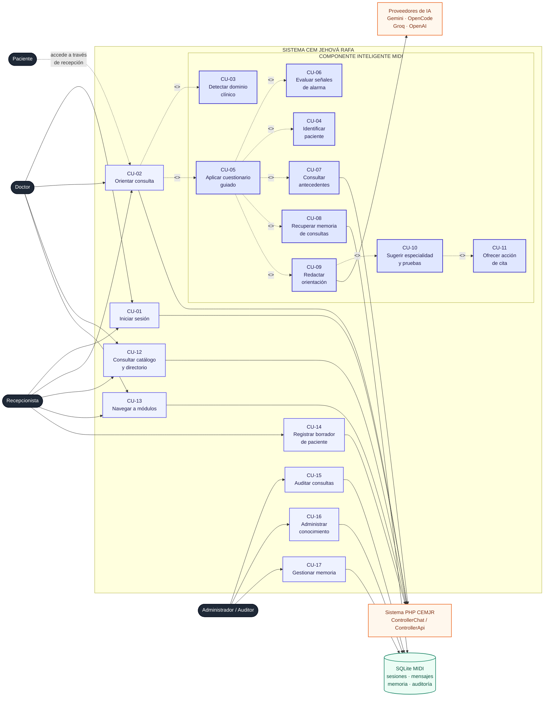
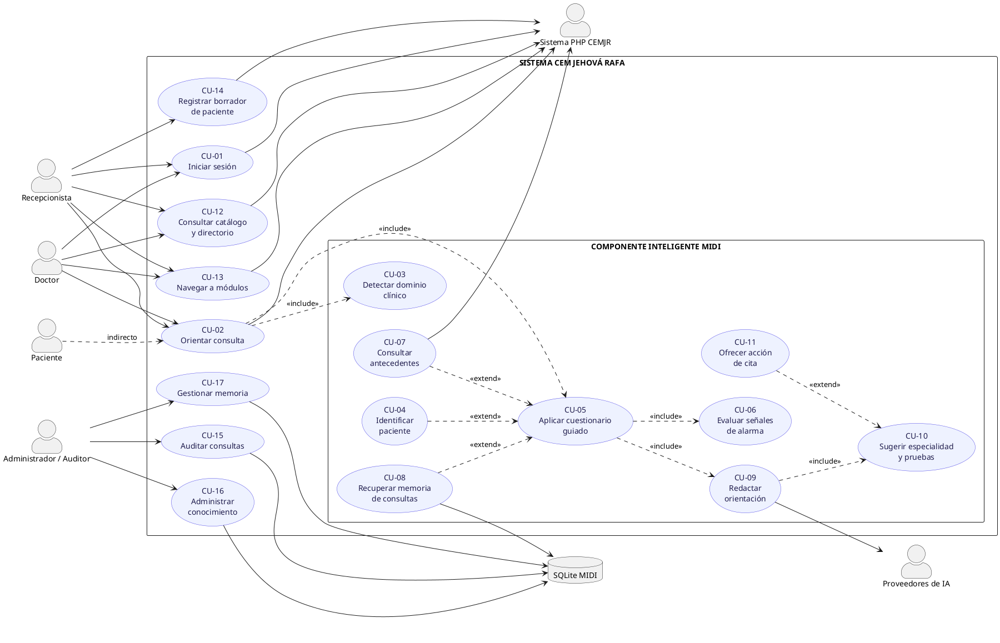

# 1. Diagrama general de casos de uso del sistema

## 1.1 Ficha del diagrama

| Elemento | Detalle |
|---|---|
| **Nombre** | Diagrama general de casos de uso del sistema CEM Jehová Rafa con énfasis en MIDI |
| **Tipo** | Diagrama UML de casos de uso (vista de contexto) |
| **Propósito** | Identificar actores, servicios del sistema y el lugar que ocupa el componente inteligente dentro de la operación de la clínica |
| **Alcance** | Sistema web CEM Jehová Rafa + componente inteligente MIDI |
| **Nivel** | Contexto general / caja negra |
| **Actor principal** | Recepcionista (secretaría) |
| **Actores secundarios** | Doctor, Administrador/Auditor, sistema PHP CEMJR, proveedores de IA, SQLite MIDI |
| **Fuente** | `main.py`, `guia.md`, `ai/`, `tools/`, `config/modulos.py`, `EGM.md` |

## 1.2 Diagrama principal

> **Lectura del diagrama:** la frontera gris representa el sistema CEM Jehová Rafa. El recuadro índigo contiene los casos de uso que ejecuta el componente inteligente MIDI. Las flechas punteadas con `<<include>>` y `<<extend>>` muestran dependencias internas; las flechas continuas hacia la derecha conectan con sistemas externos.

> **Nota de modelado:** las relaciones `<<include>>` y `<<extend>>` describen el camino principal con dominio conocido. El flujo alternativo sin dominio, que utiliza el modelo de lenguaje, se documenta en la sección 1.5.3.

## 1.3 Actores del sistema

| Actor | Tipo | Descripción | Interacción con MIDI |
|---|---|---|---|
| **Recepcionista / Secretaría** | Primario | Personal que atiende al paciente, registra la consulta y agenda la cita. | Envía la consulta al chat, recibe la orientación, usa el botón de cita y confirma el borrador de paciente. |
| **Doctor** | Primario | Profesional que consulta su información y navega por los módulos clínicos. | Puede consultar su propio historial y usar la navegación; no puede registrar pacientes desde el chat. |
| **Administrador / Auditor** | Primario | Responsable de revisar trazabilidad, conocimiento aprendido y memoria. | Consulta auditoría, agrega conocimiento y gestiona la memoria del componente. |
| **Paciente** | Indirecto | Persona atendida en la clínica. | No accede directamente al sistema; su consulta llega por intermedio de recepción. |
| **Sistema PHP CEMJR** | Secundario (sistema) | Sistema de gestión existente: autenticación, pacientes, citas, catálogo y datos clínicos. | Provee identidad, catálogo y datos de solo lectura a MIDI mediante `/Api/...`. |
| **Proveedores de IA** | Secundario (sistema) | Servicios externos de lenguaje y embeddings. | Reciben el prompt clínico y devuelven la orientación estructurada. |
| **SQLite MIDI** | Secundario (sistema) | Persistencia local del componente. | Guarda sesiones, mensajes, memoria y auditoría; no es la base clínica. |

## 1.4 Catálogo de casos de uso

| ID | Caso de uso | Actor primario | Propósito | Relación | Evidencia en el código |
|---|---|---|---|---|---|
| **CU-01** | Iniciar sesión | Recepcionista, Doctor | Autenticarse en el sistema PHP y abrir el chat. | — | `ControllerChat`, sesión PHP |
| **CU-02** | Orientar consulta | Recepcionista, Doctor | Enviar el motivo de consulta y recibir una respuesta estructurada. | Incluye CU-03 y CU-05 | `POST /orientar` en `main.py` |
| **CU-03** | Detectar dominio clínico | MIDI | Clasificar la consulta en dolor torácico, fiebre, dolor abdominal, lesión en la piel o «sin dominio». | `<<include>>` de CU-02 | `ai/cuestionario.py:detectar_dominio` |
| **CU-04** | Identificar paciente | Recepcionista, MIDI | Resolver al paciente por cédula o nombre para cargar su contexto. | `<<extend>>` de CU-05 | `_resolver_paciente`, `php_client.buscar_paciente` |
| **CU-05** | Aplicar cuestionario guiado | MIDI | Realizar entre 3 y 5 preguntas y decidir cuándo hay información suficiente. | `<<include>>` de CU-02 | `_flujo_cuestionario`, `cuestionario.py` |
| **CU-06** | Evaluar señales de alarma | MIDI | Interrumpir el cuestionario y derivar a emergencia si hay un signo de alarma. | `<<include>>` de CU-05 | `cuestionario.hay_alarma` |
| **CU-07** | Consultar antecedentes | MIDI | Leer controles y patologías del paciente para contextualizar la orientación. | `<<extend>>` de CU-05 | `_cargar_contexto`, `php_client` |
| **CU-08** | Recuperar memoria de consultas | MIDI | Reutilizar resúmenes clínicos y búsqueda por similitud. | `<<extend>>` de CU-05 | `storage/memoria.py`, `ai/embeddings.py` |
| **CU-09** | Redactar orientación | MIDI | Generar el mensaje final con lenguaje no diagnóstico. | `<<include>>` de CU-05 | `proveedor.orientar`, `guia.md` |
| **CU-10** | Sugerir especialidad y pruebas | MIDI | Asociar el caso a una especialidad real del catálogo y a pruebas orientativas. | `<<include>>` de CU-09 | `especialidad_candidata`, `validar_respuesta` |
| **CU-11** | Ofrecer acción de cita | MIDI | Devolver el botón que abre el módulo de citas con la especialidad preseleccionada. | `<<extend>>` de CU-10 | `_accion`, `config/modulos.py` |
| **CU-12** | Consultar catálogo y directorio | Recepcionista, Doctor | Ver especialidades disponibles y doctores por especialidad. | — | `get_catalogo_especialidades`, `listar_doctores` |
| **CU-13** | Navegar a módulos | Recepcionista, Doctor | Abrir un módulo del sistema PHP mediante un botón de acción. | — | `RUTAS_FRONTEND`, `ETIQUETAS_MODULOS` |
| **CU-14** | Registrar borrador de paciente | Recepcionista | Recoger los datos y devolver un borrador para que PHP confirme el alta (endpoint PHP propuesto). | — | `guia.md`, `RespuestaOrientacion.paciente_borrador` |
| **CU-15** | Auditar consultas | Administrador / Auditor | Consultar el registro append-only de consultas, modelo, latencia y respuesta. | — | `auditoria.registrar`, `GET /auditoria` |
| **CU-16** | Administrar conocimiento | Administrador / Auditor | Añadir ejemplos y palabras clave a un dominio sin tocar código. | — | `GET/POST /conocimiento` |
| **CU-17** | Gestionar memoria | Administrador / Auditor | Consultar memorias similares o borrar la memoria de un usuario/paciente. | — | `GET /memoria/similares`, `DELETE /memoria` |

## 1.5 Caso de uso central: CU-02 «Orientar consulta»

### 1.5.1 Identificación

| Campo | Valor |
|---|---|
| **Caso de uso** | CU-02 — Orientar consulta |
| **Actores** | Recepcionista (primario), MIDI (sistema), PHP CEMJR (secundario), proveedor de IA (secundario) |
| **Precondición** | El usuario tiene sesión activa en PHP; el proxy envía `X-API-Key` válida y los headers `X-Usuario-Id`, `X-Usuario-Rol` y `X-Usuario-Nombre`. |
| **Postcondición** | Se devuelve un JSON `RespuestaOrientacion`; la sesión, los mensajes y la auditoría quedan persistidos en SQLite. |
| **Frecuencia** | Alta; es el flujo principal del asistente. |

### 1.5.2 Flujo principal

1. La recepcionista escribe el motivo de consulta en el chat del sistema PHP.
2. `ControllerChat` agrega la API key y los datos del usuario, y llama a `POST /orientar`.
3. FastAPI valida la API key y recupera la sesión y el historial reciente.
4. MIDI detecta el dominio clínico mediante palabras clave y similitud con ejemplos aprendidos.
5. Si hay dominio, inicia o continúa el cuestionario guiado.
6. Si el motivo contiene una cédula, MIDI busca al paciente y carga controles y patologías.
7. MIDI evalúa señales de alarma; si existen, responde `emergencia` y no hace más preguntas.
8. Si no hay alarma, formula la siguiente pregunta del dominio y devuelve `aclaracion` con el progreso.
9. Cuando hay información suficiente, construye la ficha clínica y la envía al proveedor de IA.
10. El proveedor devuelve un JSON; MIDI lo valida contra el esquema y el catálogo real de especialidades.
11. MIDI agrega la acción sugerida (agendar cita o ver catálogo) y persiste estado, mensajes y auditoría.
12. El navegador pinta la respuesta y, si aplica, muestra el botón de acción.

### 1.5.3 Flujos alternativos

| Escenario | Comportamiento |
|---|---|
| **Sin dominio conocido** | MIDI usa el flujo general con el modelo de lenguaje y un máximo de 5 preguntas antes de forzar el cierre. |
| **Paciente no encontrado** | Se pregunta la cédula una sola vez; si no se obtiene, se continúa sin historial clínico. |
| **Emergencia** | Se responde de inmediato con `tipo_respuesta: "emergencia"` y se recomienda acudir a Emergencia. |
| **Especialidad inexistente** | La respuesta se degrada a `catalogo` y se muestran las especialidades reales. |
| **Fallo del proveedor principal** | Se recorre la cadena de respaldo configurada; si todos fallan, se devuelve `derivar` con un mensaje controlado. |
| **Catálogo no disponible** | El prompt indica «catálogo no disponible» y la respuesta se orienta a `derivar`. |
| **Sesión ya completada** | El siguiente mensaje inicia una nueva consulta. |

### 1.5.4 Excepciones

| Excepción | Respuesta del sistema |
|---|---|
| API key ausente o inválida | `401` — «API key inválida». |
| Servicio sin configurar | `503` — «Servicio no configurado». |
| Error no controlado en el procesamiento | Se registra en el log y se devuelve `derivar` con mensaje de reintento. |
| Respuesta del modelo no parseable | Se devuelve `derivar` con mensaje de consulta médica. |
| Fallo al registrar auditoría | Se registra en el log; no se interrumpe la respuesta al usuario. |

## 1.6 Matriz de trazabilidad actor — caso de uso

| Caso de uso | Recepcionista | Doctor | Administrador / Auditor | Sistema PHP | MIDI | IA | SQLite |
|---|:---:|:---:|:---:|:---:|:---:|:---:|:---:|
| CU-01 Iniciar sesión | ● | ● | ● | ● | | | |
| CU-02 Orientar consulta | ● | ● | | ● | ● | ● | ● |
| CU-03 Detectar dominio | | | | | ● | | |
| CU-04 Identificar paciente | ● | | | ● | ● | | |
| CU-05 Cuestionario guiado | ● | | | | ● | | |
| CU-06 Señales de alarma | | | | | ● | | |
| CU-07 Consultar antecedentes | | | | ● | ● | | |
| CU-08 Recuperar memoria | | | | | ● | | ● |
| CU-09 Redactar orientación | | | | | ● | ● | |
| CU-10 Especialidad y pruebas | | | | ● | ● | ● | |
| CU-11 Acción de cita | ● | | | ● | ● | | |
| CU-12 Catálogo y directorio | ● | ● | | ● | ● | | |
| CU-13 Navegar a módulos | ● | ● | | ● | ● | | |
| CU-14 Registrar borrador | ● | | | ● | ● | | |
| CU-15 Auditar consultas | | | ● | | ● | | ● |
| CU-16 Administrar conocimiento | | | ● | | ● | | ● |
| CU-17 Gestionar memoria | | | ● | | ● | | ● |

**Leyenda:** ● = participa directamente.

## 1.7 Requisitos funcionales que soporta el diagrama

| ID | Requisito | Casos de uso asociados |
|---|---|---|
| **RF-01** | Autenticar e identificar al usuario que consulta. | CU-01, CU-02 |
| **RF-02** | Recibir una consulta en lenguaje natural y devolver una respuesta estructurada. | CU-02, CU-09 |
| **RF-03** | Clasificar la consulta en un dominio clínico conocido. | CU-03 |
| **RF-04** | Realizar un cuestionario guiado y recordar las respuestas de la sesión. | CU-05 |
| **RF-05** | Detectar señales de alarma y derivar a emergencia. | CU-06 |
| **RF-06** | Recuperar antecedentes clínicos de solo lectura. | CU-04, CU-07 |
| **RF-07** | Sugerir una especialidad existente y pruebas orientativas. | CU-10 |
| **RF-08** | Ofrecer una acción concreta de navegación o cita. | CU-11, CU-13 |
| **RF-09** | Registrar cada consulta para auditoría y trazabilidad. | CU-15 |
| **RF-10** | Permitir el aprendizaje de nuevas frases y palabras clave. | CU-16 |
| **RF-11** | Gestionar la memoria por usuario y paciente. | CU-08, CU-17 |
| **RF-12** | Devolver un borrador de paciente sin escribir en la base clínica. | CU-14 |

## 1.8 Alcance y límites que deben explicarse en la presentación

| Dentro del alcance | Fuera del alcance |
|---|---|
| Orientación hacia una especialidad del catálogo. | Diagnóstico definitivo o prescripción de medicamentos. |
| Cuestionario guiado de 3 a 5 preguntas. | Tratamiento, dosis o recomendaciones de cuidados en casa. |
| Lectura de antecedentes clínicos por HTTP. | Escritura directa en MariaDB o creación de pacientes desde FastAPI. |
| Borrador de paciente para confirmación en PHP. | Alta definitiva del paciente desde MIDI. |
| Botón de acción hacia el módulo de citas. | Reserva o validación de disponibilidad de citas dentro del chat. |
| Auditoría y memoria local en SQLite. | Uso de SQLite como base clínica o fuente de verdad del paciente. |
| Cadena de respaldo entre proveedores de IA. | Garantía de disponibilidad absoluta de un proveedor externo. |

## 1.9 Guion breve para la diapositiva

> «Este diagrama responde tres preguntas: quién usa el sistema, qué servicios ofrece y dónde está la inteligencia. La recepcionista y el doctor entran por el sistema PHP; el paciente llega de forma indirecta. El recuadro índigo es MIDI: detecta el dominio, aplica un cuestionario, revisa alarmas, consulta antecedentes y redacta una orientación. La decisión clínica final siempre queda en manos del médico. Los nodos naranjas muestran que MIDI no reemplaza al sistema existente: lo consulta mediante una API de solo lectura y devuelve un JSON que el frontend pinta.»

## 1.10 Apéndice: fuente PlantUML equivalente

