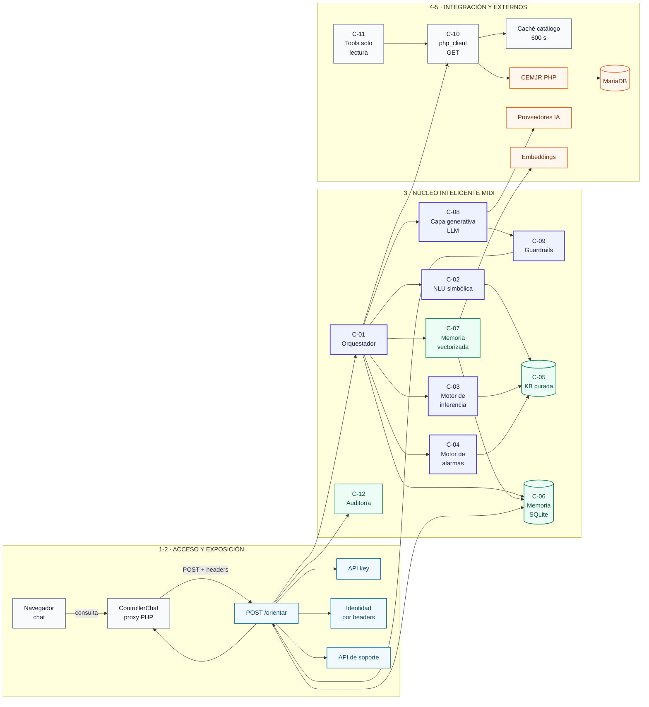
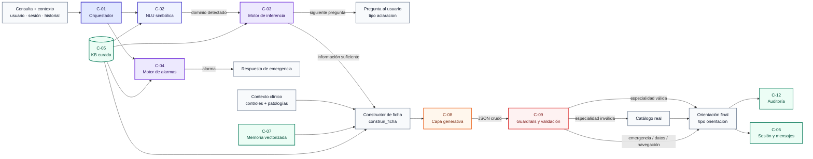
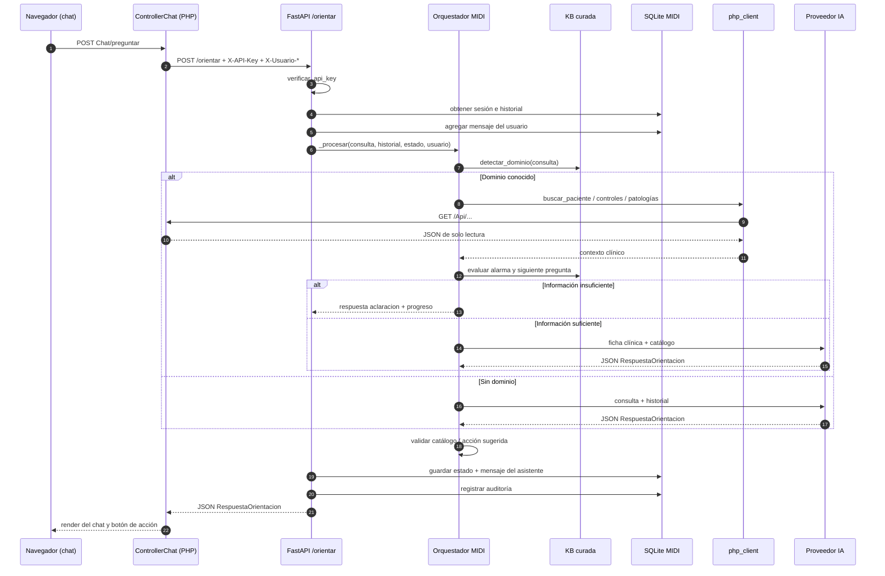
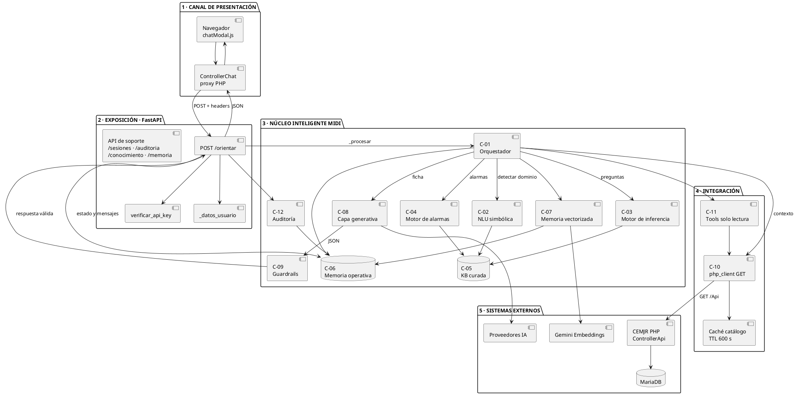
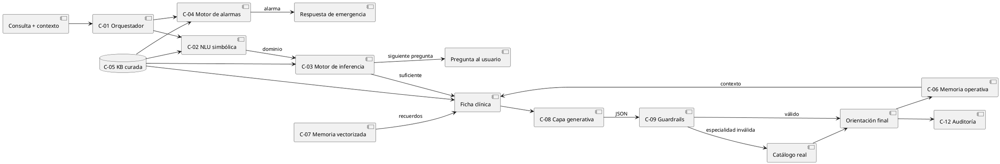

# 2. Arquitectura del componente inteligente

## 2.1 Ficha del diagrama

| Elemento | Detalle |
|---|---|
| **Nombre** | Arquitectura del componente inteligente MIDI |
| **Tipo** | Diagrama de arquitectura por capas + vista de componentes del núcleo inteligente |
| **Propósito** | Evidenciar dónde reside la inteligencia, cómo se coordinan sus componentes y cómo se integra con el sistema PHP y los proveedores de IA |
| **Alcance** | Servicio FastAPI MIDI, base de conocimiento, memoria, proveedores de IA y sistemas externos |
| **Nivel** | Arquitectura lógica / componentes |
| **Fuente** | `main.py`, `ai/`, `tools/`, `storage/`, `knowledge/`, `config/` |

## 2.2 Vista 1: arquitectura por capas

> **Lectura del diagrama:** se organiza en tres columnas. La izquierda muestra el acceso y la exposición; el centro, el núcleo inteligente; la derecha, la integración y los sistemas externos. Las etiquetas son cortas para favorecer la lectura en diapositiva; el detalle de archivos y funciones está en la tabla 2.4.

## 2.3 Vista 2: componentes del núcleo inteligente

> **Lectura del diagrama:** esta vista aísla el núcleo. Se distinguen cuatro formas de inteligencia: **simbólica** (reglas y palabras clave), **determinista** (máquina de estados), **estadística** (similitud y embeddings) y **generativa** (modelo de lenguaje). Los guardrails controlan la salida antes de llegar al usuario.

## 2.4 Inventario de componentes

| ID | Componente | Archivo / función | Tipo de inteligencia | Entradas | Salidas |
|---|---|---|---|---|---|
| **C-01** | Orquestador de diálogo | `main.py:_procesar`, `_flujo_cuestionario`, `_flujo_general`, `_finalizar` | Híbrida (coordina reglas y LLM) | Consulta, sesión, usuario, historial | Respuesta estructurada |
| **C-02** | Comprensión simbólica / detección de dominio | `ai/cuestionario.py:detectar_dominio`, `_similitud` | Simbólica + estadística léxica | Texto libre | Clave de dominio o `None` |
| **C-03** | Motor de inferencia del cuestionario | `ai/cuestionario.py:proxima_pregunta`, `registrar_respuesta`, `es_suficiente`, `progreso` | Determinista (máquina de estados) | Estado de la sesión y KB | Siguiente pregunta o cierre |
| **C-04** | Motor de alarmas | `ai/cuestionario.py:hay_alarma` | Simbólica (reglas) | Motivo y respuestas | Booleano de emergencia |
| **C-05** | Base de conocimiento curada | `knowledge/dominios.json`, `knowledge/aprendido.json` | Conocimiento declarativo | — | Dominios, preguntas, señales, pruebas |
| **C-06** | Memoria operativa | `storage/sesiones.py`, `storage/memoria.py` | Persistencia | Sesión, usuario, paciente | Estado, historial, resúmenes |
| **C-07** | Memoria vectorizada | `ai/embeddings.py`, `storage/memoria.py` | Estadística (similitud coseno) | Texto de resumen o consulta | Vector y ranking de recuerdos |
| **C-08** | Capa generativa | `ai/gemini.py`, `ai/openai_compatible.py`, `ai/proveedores.py`, `guia.md` | Generativa (LLM) | Ficha clínica o consulta + historial | JSON `RespuestaOrientacion` |
| **C-09** | Guardrails y validación | `ai/schemas.py`, `ai/comun.py:validar_respuesta` | Simbólica (validación) | JSON del modelo | Respuesta corregida y segura |
| **C-10** | Adaptador de integración PHP | `tools/php_client.py` | Integración (solo GET) | Endpoint y headers | JSON de PHP o `None` |
| **C-11** | Herramientas de solo lectura | `tools/clinica.py:TOOLS` | Tool calling | Argumentos de la herramienta | Datos clínicos o directorio |
| **C-12** | Auditoría | `storage/auditoria.py` | Trazabilidad | Evento de consulta | Registro append-only |

## 2.5 ¿Dónde se evidencia la inteligencia?

| Mecanismo | Implementación | Qué aporta | Límite de diseño |
|---|---|---|---|
| **Clasificación simbólica** | Coincidencia normalizada de palabras clave y similitud Jaccard ≥ 0,6 con ejemplos aprendidos. | Clasifica el motivo en un dominio sin depender del LLM; es reproducible. | Si la frase no comparte tokens ni palabras clave, cae al flujo general. |
| **Aprendizaje incremental** | `aprender_ejemplo` y `aprender_palabras` guardan frases y claves en `aprendido.json`; se fusionan al cargar. | MIDI mejora el reconocimiento con el uso real, sin reentrenar el modelo. | Máximo de 50 ejemplos por dominio; requiere revisión humana. |
| **Máquina de estados** | `nueva_sesion`, `proxima_pregunta`, `registrar_respuesta`, `es_suficiente`, `progreso`. | Garantiza 3–5 preguntas, evita repetir y permite mostrar progreso. | Las preguntas son finitas y curadas por dominio. |
| **Razonamiento por reglas** | `hay_alarma`, `especialidad_candidata`, `resumen_contexto`, `construir_ficha`. | Aplica criterios clínicos explícitos y auditables. | No sustituye el juicio médico. |
| **Recuperación de contexto** | `_resolver_paciente`, `_cargar_contexto`, `php_client`. | Personaliza la orientación con controles y patologías reales. | Solo lectura; depende de la disponibilidad de PHP. |
| **Memoria semántica** | `embeddings.embed`, `memoria.buscar_similares`, similitud coseno. | Permite recuperar resúmenes parecidos por significado. | La recuperación automática en la ficha está disponible como capacidad, pero el flujo actual prioriza la memoria exacta por usuario/paciente. |
| **Generación controlada** | Prompt `guia.md` + catálogo real + esquema Pydantic + `validar_respuesta`. | Redacta una orientación natural sin inventar especialidades. | El modelo no decide el botón ni la ruta; eso lo hace FastAPI. |
| **Cadena de respaldo** | `ProveedorFallback` y modelos de respaldo. | Mantiene el servicio ante 503, 429 o timeout. | No garantiza disponibilidad si todos los proveedores fallan. |

## 2.6 Flujo de datos de una consulta

| Paso | Acción | Componente | Persistencia |
|---:|---|---|---|
| 1 | El navegador envía la consulta al proxy PHP. | Canal | — |
| 2 | PHP agrega API key y headers de usuario y llama a `/orientar`. | Exposición | — |
| 3 | FastAPI valida la API key y recupera la sesión. | `verificar_api_key`, `sesiones` | SQLite |
| 4 | Se recupera el historial reciente y se registra el mensaje del usuario. | `historial_para_gemini`, `agregar_mensaje` | SQLite |
| 5 | Se detecta el dominio clínico. | `detectar_dominio` | — |
| 6 | Se resuelve el paciente y se carga su contexto. | `_resolver_paciente`, `_cargar_contexto` | SQLite / PHP |
| 7 | Se evalúan señales de alarma. | `hay_alarma` | — |
| 8 | Se elige la siguiente pregunta o se cierra el cuestionario. | `proxima_pregunta`, `es_suficiente` | — |
| 9 | Se construye la ficha clínica. | `construir_ficha` | — |
| 10 | El proveedor de IA redacta la orientación. | `proveedor.orientar` | — |
| 11 | Se valida el JSON contra el esquema y el catálogo. | `RespuestaOrientacion`, `validar_respuesta` | — |
| 12 | Se agrega la acción sugerida. | `_accion`, `construir_accion` | — |
| 13 | Se guarda el estado y el mensaje del asistente. | `guardar_estado`, `agregar_mensaje` | SQLite |
| 14 | Se registra la auditoría. | `auditoria.registrar` | SQLite |
| 15 | Se devuelve el JSON al proxy y se pinta en el chat. | Exposición / canal | — |

## 2.7 Diagrama de secuencia complementario

## 2.8 Decisiones de arquitectura

| ID | Decisión | Justificación | Consecuencia |
|---|---|---|---|
| **DA-01** | Separar el motor determinista del LLM. | El LLM no decide cuándo preguntar ni cuándo terminar; eso hace el cuestionario. | Respuestas más reproducibles y auditables. |
| **DA-02** | Inyectar el catálogo real en el prompt y validarlo después. | Evita sugerir especialidades inexistentes. | Si el catálogo no está disponible, se degrada a `derivar` o `catalogo`. |
| **DA-03** | No escribir en MariaDB. | MIDI es un componente de orientación, no el sistema de registro clínico. | Toda escritura clínica queda en PHP. |
| **DA-04** | Persistir sesiones, memoria y auditoría en SQLite. | Aísla al componente y evita acoplamiento con la base clínica. | Requiere respaldo y retención propios. |
| **DA-05** | Usar una cadena de proveedores. | Un pico de demanda o cuota no debe tumbar la demo. | Aumenta la complejidad de configuración y logs. |
| **DA-06** | Validar la salida con Pydantic y reglas de catálogo. | El modelo puede alucinar o devolver JSON inválido. | Se devuelve una respuesta controlada en lugar de un error. |
| **DA-07** | Decidir el botón de acción en FastAPI, no en el modelo. | Evita rutas inventadas o acciones no autorizadas. | El botón solo aparece con especialidad válida. |
| **DA-08** | Mantener herramientas de solo lectura. | Reduce el riesgo de acciones clínicas no autorizadas. | El alta de paciente se confirma en PHP (endpoint propuesto) y la cita se gestiona en el módulo existente. |

## 2.9 Requisitos no funcionales asociados

| ID | Requisito | Cómo se atiende |
|---|---|---|
| **RNF-01** | Seguridad de acceso | `X-API-Key` con comparación en tiempo constante; identidad por headers del proxy. |
| **RNF-02** | Privacidad | MIDI no escribe en la base clínica; la auditoría es local y debe tener retención controlada. |
| **RNF-03** | Disponibilidad | Cadena de proveedores, timeouts y respuestas de respaldo. |
| **RNF-04** | Rendimiento | Caché de catálogo de 10 minutos, embeddings en segundo plano y límite de historial. |
| **RNF-05** | Trazabilidad | Auditoría append-only con modelo, latencia, dominio y respuesta. |
| **RNF-06** | Consistencia del contrato | Esquema `RespuestaOrientacion` y validación defensiva. |
| **RNF-07** | Mantenibilidad | KB en JSON, rutas en `config/modulos.py`, proveedores intercambiables. |
| **RNF-08** | Explicabilidad | Reglas explícitas, catálogo real y lenguaje no diagnóstico. |

## 2.10 Límites y observaciones para la defensa

| Tema | Estado actual | Implicación |
|---|---|---|
| Diagnóstico | Prohibido por prompt y por diseño. | MIDI orienta y deriva; no diagnostica ni receta. |
| Escritura clínica | No existe desde FastAPI. | El alta de paciente se confirma en PHP (endpoint propuesto); la cita se gestiona en el módulo existente. |
| Disponibilidad de citas | No se consulta dentro del chat. | El botón abre el módulo; no reserva. |
| Memoria vectorizada | Se calcula y se expone por `/memoria/similares`. | La ficha admite `recuerdos`, pero el flujo actual usa la memoria exacta por usuario/paciente. |
| Aprendizaje | Guarda ejemplos y palabras clave. | No reentrena el modelo; mejora la clasificación simbólica. |
| Dependencia externa | PHP y proveedores de IA. | Si fallan, hay respuestas de respaldo, pero se degrada la orientación. |
| Auditoría | Append-only local. | Falta definir política formal de retención y borrado. |

## 2.11 Guion breve para la diapositiva

> «La arquitectura separa responsabilidades. El canal y el proxy PHP no contienen inteligencia: solo transportan. FastAPI expone el contrato. El núcleo índigo es donde ocurre la inteligencia: una capa simbólica detecta el dominio, un motor determinista decide qué preguntar, un motor de alarmas protege el caso urgente, una base de conocimiento curada aporta las reglas y una capa generativa redacta la orientación. Antes de responder, los guardrails validan el esquema y el catálogo real. Nada de esto escribe en la base clínica: MIDI lee por HTTP y devuelve un JSON que el sistema PHP pinta.»

## 2.12 Apéndice: fuente PlantUML de la vista por capas

## 2.13 Apéndice: fuente PlantUML del núcleo inteligente

