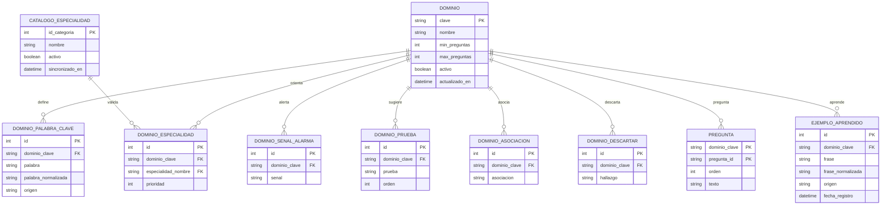
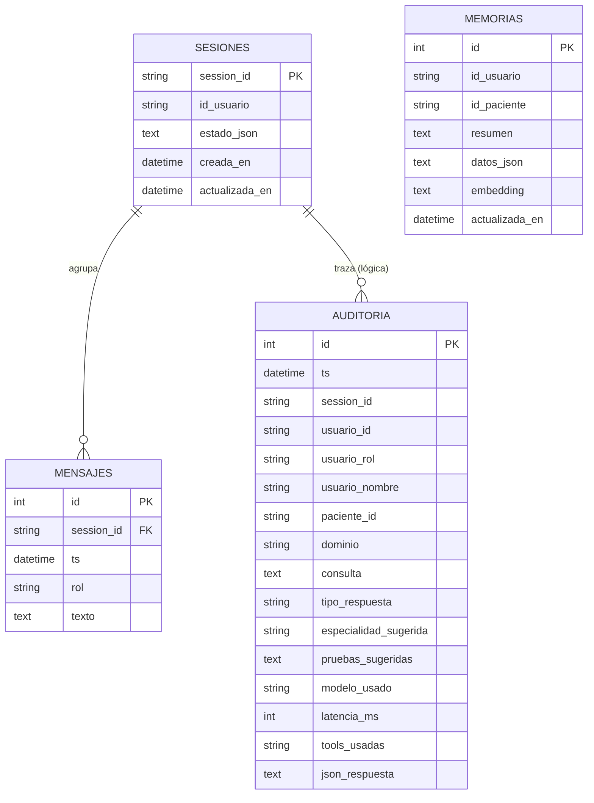
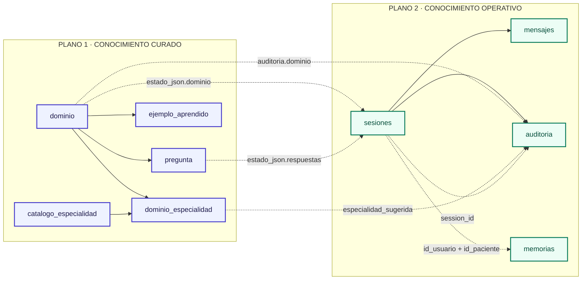

# 3. Base de conocimiento: tablas y relaciones

## 3.1 Ficha del diagrama

| Elemento | Detalle |
|---|---|
| **Nombre** | Modelo relacional de la base de conocimiento de MIDI |
| **Tipo** | Diagrama entidad-relación (ER) + diccionario de datos |
| **Propósito** | Presentar las tablas que conforman la base de conocimiento, sus llaves, cardinalidades y reglas de integridad |
| **Alcance** | Conocimiento curado, conocimiento aprendido, catálogo de especialidades y memoria operativa/auditoría |
| **Nivel** | Modelo lógico-relacional |
| **Fuente** | `knowledge/dominios.json`, `knowledge/aprendido.json`, `storage/db.py`, `storage/*.py` |

## 3.2 Dos planos de conocimiento

MIDI separa el conocimiento en dos planos que se complementan:

| Plano | Qué contiene | Implementación actual | Uso |
|---|---|---|---|
| **Plano 1 — Conocimiento curado** | Dominios clínicos, preguntas, palabras clave, señales de alarma, especialidades, pruebas, asociaciones y hallazgos a descartar. | Tablas SQLite de `storage/schema.sql` (Fase 1). `knowledge/*.json` queda solo como semilla de migración. | Alimenta la detección de dominio, el cuestionario y la ficha clínica. |
| **Plano 2 — Conocimiento operativo** | Sesiones, mensajes, consultas, turnos, resúmenes de memoria, embeddings y auditoría. | Tablas SQLite en `storage/midi.db`. | Conserva el estado de la conversación, la identidad del caso, la memoria por usuario/paciente y la trazabilidad. |

> **Estado de implementación (2026-11-26):** el plano 1 ya está desplegado como tablas SQLite. `scripts/seed_kb.py` migra los JSON una sola vez y publica una `kb_version` con snapshot y hash SHA-256. El runtime lee la KB activa con `storage/conocimiento.py`; no vuelve a abrir los JSON. Cada tabla de lista tiene `activo` y `estado`, y las palabras/señales conservan alias con `alias_de`. La identidad `consulta`/`turno` añade idempotencia por `peticion_id` y separa el caso clínico de la sesión de chat.

### 3.2.1 Mapeo del modelo anterior al implementado

| Modelo anterior | Implementación Fase 1 |
|---|---|
| `dominio` | `dominio` |
| `dominio_palabra_clave` | `dominio_palabra_clave` (+ `alias_de`, `origen`, `activo`, `estado`) |
| `dominio_senal_alarma` | `dominio_senal_alarma` (+ `alias_de`, `origen`, `activo`, `estado`) |
| `dominio_pregunta` | `dominio_pregunta` (+ `orden`, `activo`, `estado`) |
| `dominio_especialidad` / `catalogo_especialidad` | `dominio_especialidad` (nombre normalizado) |
| `dominio_prueba`, `dominio_asociacion`, `dominio_descartar` | mismas tablas + `orden`, `activo`, `estado` |
| Conocimiento aprendido en JSON | `dominio_ejemplo` y `dominio_palabra_clave` con `origen = 'aprendido'` |
| Versión de conocimiento implícita | `kb_version` + `kb_version_item` (snapshot y hash) |
| Sesión de chat como caso | `sesiones` (chat) + `consulta` / `turno` (caso clínico) |


## 3.3 Diagrama A: base de conocimiento curada (modelo normalizado)

> **Lectura:** cada `dominio` concentra las reglas de un motivo clínico. Las entidades hijas almacenan las listas que en el JSON son arreglos: palabras clave, señales de alarma, especialidades, pruebas, asociaciones, hallazgos a descartar y preguntas. `catalogo_especialidad` valida que la especialidad sugerida exista realmente en el CEM.



## 3.4 Diagrama B: base de conocimiento operativa (SQLite actual)

> **Lectura:** `sesiones` guarda la ficha del cuestionario en `estado_json`; `mensajes` conserva el historial; `memorias` resume el contexto por usuario/paciente; `auditoria` es append-only. Las relaciones son lógicas: SQLite no declara llaves foráneas en el esquema actual, por lo que la integridad se garantiza en la aplicación.



## 3.5 Diagrama C: relaciones entre ambos planos

> **Lectura:** las líneas punteadas representan relaciones lógicas por valor (no llaves foráneas físicas). El dominio de la KB curada se referencia desde el estado de la sesión y desde la auditoría; la especialidad sugerida se contrasta con el catálogo real; la sesión se relaciona con sus mensajes y con la memoria por usuario/paciente.



### 3.5.1 Inventario de tablas

| ID | Tabla / entidad | Plano | Propósito | Implementación actual |
|---|---|---|---|---|
| **TAB-01** | `dominio` | 1 · Curado | Entidad raíz del conocimiento clínico. | `dominios.json` |
| **TAB-02** | `dominio_palabra_clave` | 1 · Curado | Palabras que activan la detección del dominio. | Arreglo JSON |
| **TAB-03** | `dominio_senal_alarma` | 1 · Curado | Señales que derivan a emergencia. | Arreglo JSON |
| **TAB-04** | `dominio_especialidad` | 1 · Curado | Especialidades candidatas y su prioridad. | Arreglo JSON |
| **TAB-05** | `dominio_prueba` | 1 · Curado | Pruebas orientativas del dominio. | Arreglo JSON |
| **TAB-06** | `dominio_asociacion` | 1 · Curado | Posibles asociaciones clínicas. | Arreglo JSON |
| **TAB-07** | `dominio_descartar` | 1 · Curado | Hallazgos a descartar. | Arreglo JSON |
| **TAB-08** | `pregunta` | 1 · Curado | Preguntas del cuestionario guiado. | Arreglo JSON |
| **TAB-09** | `ejemplo_aprendido` | 1 · Curado | Frases aprendidas de conversaciones. | `aprendido.json` |
| **TAB-10** | `catalogo_especialidad` | 1 · Referencia | Catálogo real de especialidades del CEM. | Caché en memoria (TTL 600 s) |
| **TAB-11** | `sesiones` | 2 · Operativo | Estado de cada conversación. | SQLite |
| **TAB-12** | `mensajes` | 2 · Operativo | Historial de mensajes por sesión. | SQLite |
| **TAB-13** | `memorias` | 2 · Operativo | Resumen y embedding por usuario/paciente. | SQLite |
| **TAB-14** | `auditoria` | 2 · Operativo | Trazabilidad append-only de consultas. | SQLite |

## 3.6 Diccionario de datos — Plano 1: conocimiento curado

### TAB-01 `dominio`

Representa un motivo clínico o dominio de conocimiento. Es la entidad raíz de la KB.

| Columna | Tipo lógico | Restricción | Descripción |
|---|---|---|---|
| `clave` | Texto | **PK** | Identificador estable del dominio. Ej.: `dolor_toracico`. |
| `nombre` | Texto | NOT NULL | Nombre visible. Ej.: «Dolor torácico». |
| `min_preguntas` | Entero | NOT NULL, ≥ 1 | Mínimo de preguntas para considerar información suficiente. |
| `max_preguntas` | Entero | NOT NULL, ≥ `min_preguntas` | Máximo de preguntas antes de cerrar el cuestionario. |
| `activo` | Booleano | NOT NULL, default `true` | Permite retirar un dominio sin borrar su historial. |
| `actualizado_en` | Fecha/hora | NOT NULL | Última modificación de la definición. |

**Origen JSON:** `dominios.json[clave]` → `nombre`, `min_preguntas`, `max_preguntas`.

### TAB-02 `dominio_palabra_clave`

Palabras o frases que activan la detección directa del dominio.

| Columna | Tipo lógico | Restricción | Descripción |
|---|---|---|---|
| `id` | Entero | **PK**, autoincremental | Identificador de la fila. |
| `dominio_clave` | Texto | **FK** → `dominio.clave`, NOT NULL | Dominio al que pertenece la palabra. |
| `palabra` | Texto | NOT NULL | Palabra o frase clave, sin normalizar. |
| `palabra_normalizada` | Texto | NOT NULL | Palabra sin tildes ni mayúsculas, para comparar. |
| `origen` | Texto | `curada` / `aprendida` | Procedencia del término. |

**Restricción:** `UNIQUE (dominio_clave, palabra_normalizada)`.

**Origen JSON:** `dominios.json[clave].palabras_clave[]` y `aprendido.json[clave].palabras_clave[]`.

### TAB-03 `dominio_senal_alarma`

Señales que obligan a derivar de inmediato a emergencia.

| Columna | Tipo lógico | Restricción | Descripción |
|---|---|---|---|
| `id` | Entero | **PK** | Identificador de la fila. |
| `dominio_clave` | Texto | **FK** → `dominio.clave`, NOT NULL | Dominio al que aplica la señal. |
| `senal` | Texto | NOT NULL | Frase o síntoma de alarma. |

**Restricción:** `UNIQUE (dominio_clave, senal)`.

**Origen JSON:** `dominios.json[clave].senal_alarma[]`.

### TAB-04 `dominio_especialidad`

Especialidades candidatas del dominio, ordenadas por prioridad.

| Columna | Tipo lógico | Restricción | Descripción |
|---|---|---|---|
| `id` | Entero | **PK** | Identificador de la fila. |
| `dominio_clave` | Texto | **FK** → `dominio.clave`, NOT NULL | Dominio de origen. |
| `especialidad_nombre` | Texto | **FK lógica** → `catalogo_especialidad.nombre` | Nombre de la especialidad candidata. |
| `prioridad` | Entero | NOT NULL, ≥ 1 | Orden de preferencia; 1 es la primera opción. |

**Restricción:** `UNIQUE (dominio_clave, especialidad_nombre)` y `UNIQUE (dominio_clave, prioridad)`.

**Origen JSON:** `dominios.json[clave].especialidades[]`.

### TAB-05 `dominio_prueba`

Pruebas o estudios orientativos sugeridos para el dominio.

| Columna | Tipo lógico | Restricción | Descripción |
|---|---|---|---|
| `id` | Entero | **PK** | Identificador de la fila. |
| `dominio_clave` | Texto | **FK** → `dominio.clave`, NOT NULL | Dominio de origen. |
| `prueba` | Texto | NOT NULL | Nombre del estudio. |
| `orden` | Entero | NOT NULL | Orden de presentación. |

**Restricción:** `UNIQUE (dominio_clave, orden)`.

**Origen JSON:** `dominios.json[clave].pruebas[]`.

### TAB-06 `dominio_asociacion`

Posibles asociaciones clínicas que se muestran sin afirmar diagnóstico.

| Columna | Tipo lógico | Restricción | Descripción |
|---|---|---|---|
| `id` | Entero | **PK** | Identificador de la fila. |
| `dominio_clave` | Texto | **FK** → `dominio.clave`, NOT NULL | Dominio de origen. |
| `asociacion` | Texto | NOT NULL | Asociación posible, redactada de forma condicional. |

**Origen JSON:** `dominios.json[clave].posibles_asociaciones[]`.

### TAB-07 `dominio_descartar`

Hallazgos o entidades que conviene descartar según el dominio.

| Columna | Tipo lógico | Restricción | Descripción |
|---|---|---|---|
| `id` | Entero | **PK** | Identificador de la fila. |
| `dominio_clave` | Texto | **FK** → `dominio.clave`, NOT NULL | Dominio de origen. |
| `hallazgo` | Texto | NOT NULL | Entidad o condición a descartar. |

**Origen JSON:** `dominios.json[clave].a_descartar[]`.

### TAB-08 `pregunta`

Preguntas del cuestionario guiado, ordenadas dentro de cada dominio.

| Columna | Tipo lógico | Restricción | Descripción |
|---|---|---|---|
| `dominio_clave` | Texto | **PK compuesta**, **FK** → `dominio.clave` | Dominio al que pertenece la pregunta. |
| `pregunta_id` | Texto | **PK compuesta** | Identificador de la pregunta dentro del dominio. Ej.: `intensidad`. |
| `orden` | Entero | NOT NULL | Orden de formulación. |
| `texto` | Texto | NOT NULL | Texto exacto que se muestra al usuario. |

**Restricción:** `UNIQUE (dominio_clave, orden)`.

**Origen JSON:** `dominios.json[clave].preguntas[]` con `id` y `texto`.

### TAB-09 `ejemplo_aprendido`

Frases reales que MIDI aprende para reconocer variantes del dominio.

| Columna | Tipo lógico | Restricción | Descripción |
|---|---|---|---|
| `id` | Entero | **PK** | Identificador de la fila. |
| `dominio_clave` | Texto | **FK** → `dominio.clave`, NOT NULL | Dominio reconocido. |
| `frase` | Texto | NOT NULL | Frase original del usuario. |
| `frase_normalizada` | Texto | NOT NULL | Frase sin tildes, en minúsculas, para comparar. |
| `origen` | Texto | `conversacion` / `manual` | Cómo se incorporó. |
| `fecha_registro` | Fecha/hora | NOT NULL | Momento de incorporación. |

**Restricción:** `UNIQUE (dominio_clave, frase_normalizada)`. El código limita a 50 ejemplos por dominio.

**Origen JSON:** `aprendido.json[clave].ejemplos[]`.

### TAB-10 `catalogo_especialidad`

Catálogo real de especialidades del CEM. Es una tabla de referencia; hoy se mantiene en caché de memoria con TTL de 600 segundos y no se persiste.

| Columna | Tipo lógico | Restricción | Descripción |
|---|---|---|---|
| `id_categoria` | Entero | **PK** | Identificador de la especialidad en el sistema PHP. |
| `nombre` | Texto | NOT NULL, UNIQUE | Nombre exacto que usa el catálogo. |
| `activo` | Booleano | NOT NULL, default `true` | Indica si se ofrece actualmente. |
| `sincronizado_en` | Fecha/hora | NOT NULL | Última sincronización con PHP. |

**Origen:** `GET /Api/apiEspecialidades`, cacheado por `tools/php_client.py`.

## 3.7 Diccionario de datos — Plano 2: conocimiento operativo (SQLite)

### TAB-11 `sesiones`

| Columna | Tipo SQLite | Restricción | Descripción |
|---|---|---|---|
| `session_id` | TEXT | **PK** | Identificador de la conversación. |
| `id_usuario` | TEXT | NULL | Usuario del sistema PHP que originó la sesión. |
| `estado_json` | TEXT | NOT NULL, default `'{}'` | Ficha del cuestionario serializada en JSON. |
| `creada_en` | TEXT | NOT NULL | Fecha/hora ISO 8601 en UTC. |
| `actualizada_en` | TEXT | NOT NULL | Última actualización. |

**Contenido típico de `estado_json`:**

```json
{
  "dominio": "dolor_toracico",
  "motivo": "me duele el pecho",
  "paciente_id": 123,
  "paciente_cedula": "12345678",
  "paciente_nombre": "María Pérez",
  "preguntas_hechas": ["intensidad", "irradiacion"],
  "respuestas": {
    "intensidad": "7",
    "irradiacion": "brazo izquierdo"
  },
  "siguiente_pregunta": "esfuerzo",
  "contexto": {"controles": [], "patologias": []},
  "contexto_cargado": true,
  "completo": false
}
```

### TAB-12 `mensajes`

| Columna | Tipo SQLite | Restricción | Descripción |
|---|---|---|---|
| `id` | INTEGER | **PK**, AUTOINCREMENT | Identificador del mensaje. |
| `session_id` | TEXT | NOT NULL, **FK lógica** → `sesiones.session_id` | Conversación a la que pertenece. |
| `ts` | TEXT | NOT NULL | Fecha/hora ISO 8601 en UTC. |
| `rol` | TEXT | NOT NULL; `user` / `model` | Autor del mensaje. |
| `texto` | TEXT | NOT NULL | Contenido del mensaje. |

**Índice:** `idx_mensajes_sesion (session_id)`.

### TAB-13 `memorias`

| Columna | Tipo SQLite | Restricción | Descripción |
|---|---|---|---|
| `id` | INTEGER | **PK**, AUTOINCREMENT | Identificador del registro. |
| `id_usuario` | TEXT | NOT NULL | Usuario propietario de la memoria. |
| `id_paciente` | TEXT | NOT NULL, default `''` | Paciente al que se refiere el resumen. |
| `resumen` | TEXT | NOT NULL | Resumen legible de controles y patologías. |
| `datos_json` | TEXT | NULL | Contexto clínico completo serializado. |
| `embedding` | TEXT | NULL | Vector de embeddings serializado como arreglo JSON. |
| `actualizada_en` | TEXT | NOT NULL | Última actualización. |

**Restricción:** `UNIQUE (id_usuario, id_paciente)`.

### TAB-14 `auditoria`

| Columna | Tipo SQLite | Restricción | Descripción |
|---|---|---|---|
| `id` | INTEGER | **PK**, AUTOINCREMENT | Identificador del evento. |
| `ts` | TEXT | NOT NULL | Fecha/hora ISO 8601 en UTC. |
| `session_id` | TEXT | NULL, **FK lógica** → `sesiones.session_id` | Sesión auditada. |
| `usuario_id` | TEXT | NULL | Identificador del usuario. |
| `usuario_rol` | TEXT | NULL | Rol del usuario. |
| `usuario_nombre` | TEXT | NULL | Nombre del usuario. |
| `paciente_id` | TEXT | NULL | Paciente involucrado, si se identificó. |
| `dominio` | TEXT | NULL, **FK lógica** → `dominio.clave` | Dominio detectado. |
| `consulta` | TEXT | NULL | Texto original de la consulta. |
| `tipo_respuesta` | TEXT | NULL | Tipo de respuesta emitida. |
| `especialidad_sugerida` | TEXT | NULL | Especialidad devuelta al usuario. |
| `pruebas_sugeridas` | TEXT | NULL | Lista de pruebas serializada en JSON. |
| `modelo_usado` | TEXT | NULL | Modelo o proveedor que respondió. |
| `latencia_ms` | INTEGER | NULL | Latencia total de la consulta en milisegundos. |
| `tools_usadas` | TEXT | NULL | `cuestionario` o `gemini`, según el flujo. |
| `json_respuesta` | TEXT | NULL | Respuesta completa serializada en JSON. |

**Naturaleza:** append-only. La API solo expone `GET /auditoria`; no hay endpoint de actualización ni borrado.

## 3.8 Cardinalidades y relaciones

| Relación | Cardinalidad | Obligatoriedad | Descripción |
|---|---|---|---|
| `dominio` → `pregunta` | 1 : N | 1 dominio tiene 0..N preguntas; cada pregunta pertenece a 1 dominio. | Preguntas del cuestionario. |
| `dominio` → `dominio_palabra_clave` | 1 : N | 1 dominio tiene 0..N palabras; cada palabra pertenece a 1 dominio. | Activación del dominio. |
| `dominio` → `dominio_senal_alarma` | 1 : N | 1 dominio tiene 0..N señales. | Derivación a emergencia. |
| `dominio` → `dominio_especialidad` | 1 : N | 1 dominio tiene 1..N especialidades candidatas. | Orientación. |
| `dominio` → `dominio_prueba` | 1 : N | 1 dominio tiene 0..N pruebas. | Sugerencia de estudios. |
| `dominio` → `dominio_asociacion` | 1 : N | 1 dominio tiene 0..N asociaciones. | Interpretación condicional. |
| `dominio` → `dominio_descartar` | 1 : N | 1 dominio tiene 0..N hallazgos. | Descarte orientativo. |
| `dominio` → `ejemplo_aprendido` | 1 : N | 1 dominio tiene 0..50 ejemplos. | Aprendizaje incremental. |
| `catalogo_especialidad` → `dominio_especialidad` | 1 : N | Cada especialidad candidata debe existir en el catálogo. | Validación contra el catálogo real. |
| `sesiones` → `mensajes` | 1 : N | 1 sesión tiene 0..N mensajes. | Historial de la conversación. |
| `sesiones` → `auditoria` | 1 : N | 1 sesión puede tener 0..N eventos. | Trazabilidad lógica. |
| `dominio` → `auditoria` | 1 : N | 1 dominio puede aparecer en 0..N auditorías. | Análisis de uso. |
| `memorias` | 1 : 1 por usuario/paciente | Clave única `(id_usuario, id_paciente)`. | Resumen y embedding por paciente. |

## 3.9 DDL actual de SQLite

Este es el esquema que el sistema crea hoy en `storage/midi.db`:

```sql
CREATE TABLE IF NOT EXISTS sesiones (
    session_id TEXT PRIMARY KEY,
    id_usuario TEXT,
    estado_json TEXT NOT NULL DEFAULT '{}',
    creada_en TEXT NOT NULL,
    actualizada_en TEXT NOT NULL
);

CREATE TABLE IF NOT EXISTS mensajes (
    id INTEGER PRIMARY KEY AUTOINCREMENT,
    session_id TEXT NOT NULL,
    ts TEXT NOT NULL,
    rol TEXT NOT NULL,
    texto TEXT NOT NULL
);

CREATE INDEX IF NOT EXISTS idx_mensajes_sesion ON mensajes(session_id);

CREATE TABLE IF NOT EXISTS auditoria (
    id INTEGER PRIMARY KEY AUTOINCREMENT,
    ts TEXT NOT NULL,
    session_id TEXT,
    usuario_id TEXT,
    usuario_rol TEXT,
    usuario_nombre TEXT,
    paciente_id TEXT,
    dominio TEXT,
    consulta TEXT,
    tipo_respuesta TEXT,
    especialidad_sugerida TEXT,
    pruebas_sugeridas TEXT,
    modelo_usado TEXT,
    latencia_ms INTEGER,
    tools_usadas TEXT,
    json_respuesta TEXT
);

CREATE TABLE IF NOT EXISTS memorias (
    id INTEGER PRIMARY KEY AUTOINCREMENT,
    id_usuario TEXT NOT NULL,
    id_paciente TEXT NOT NULL DEFAULT '',
    resumen TEXT NOT NULL,
    datos_json TEXT,
    embedding TEXT,
    actualizada_en TEXT NOT NULL,
    UNIQUE (id_usuario, id_paciente)
);
```

## 3.10 DDL lógico de referencia para la KB normalizada

> **Advertencia:** este DDL es una propuesta de normalización del plano 1. No se ejecuta en la versión actual, que lee los JSON directamente.

```sql
CREATE TABLE dominio (
    clave           VARCHAR(64)  PRIMARY KEY,
    nombre          VARCHAR(120) NOT NULL,
    min_preguntas   INT          NOT NULL DEFAULT 3,
    max_preguntas   INT          NOT NULL DEFAULT 5,
    activo          BOOLEAN      NOT NULL DEFAULT TRUE,
    actualizado_en  DATETIME     NOT NULL,
    CONSTRAINT ck_dominio_preguntas CHECK (min_preguntas >= 1 AND max_preguntas >= min_preguntas)
);

CREATE TABLE dominio_palabra_clave (
    id                   BIGINT       PRIMARY KEY AUTO_INCREMENT,
    dominio_clave        VARCHAR(64)  NOT NULL,
    palabra              VARCHAR(120) NOT NULL,
    palabra_normalizada  VARCHAR(120) NOT NULL,
    origen               VARCHAR(20)  NOT NULL DEFAULT 'curada',
    CONSTRAINT fk_palabra_dominio FOREIGN KEY (dominio_clave) REFERENCES dominio(clave),
    CONSTRAINT uq_palabra UNIQUE (dominio_clave, palabra_normalizada)
);

CREATE TABLE dominio_senal_alarma (
    id              BIGINT       PRIMARY KEY AUTO_INCREMENT,
    dominio_clave   VARCHAR(64)  NOT NULL,
    senal           VARCHAR(160) NOT NULL,
    CONSTRAINT fk_senal_dominio FOREIGN KEY (dominio_clave) REFERENCES dominio(clave),
    CONSTRAINT uq_senal UNIQUE (dominio_clave, senal)
);

CREATE TABLE catalogo_especialidad (
    id_categoria    INT          PRIMARY KEY,
    nombre          VARCHAR(120) NOT NULL UNIQUE,
    activo          BOOLEAN      NOT NULL DEFAULT TRUE,
    sincronizado_en DATETIME     NOT NULL
);

CREATE TABLE dominio_especialidad (
    id                  BIGINT       PRIMARY KEY AUTO_INCREMENT,
    dominio_clave       VARCHAR(64)  NOT NULL,
    especialidad_nombre VARCHAR(120) NOT NULL,
    prioridad           INT          NOT NULL,
    CONSTRAINT fk_de_dominio FOREIGN KEY (dominio_clave) REFERENCES dominio(clave),
    CONSTRAINT fk_de_especialidad FOREIGN KEY (especialidad_nombre) REFERENCES catalogo_especialidad(nombre),
    CONSTRAINT uq_de UNIQUE (dominio_clave, especialidad_nombre),
    CONSTRAINT uq_de_prioridad UNIQUE (dominio_clave, prioridad)
);

CREATE TABLE dominio_prueba (
    id              BIGINT       PRIMARY KEY AUTO_INCREMENT,
    dominio_clave   VARCHAR(64)  NOT NULL,
    prueba          VARCHAR(160) NOT NULL,
    orden           INT          NOT NULL,
    CONSTRAINT fk_prueba_dominio FOREIGN KEY (dominio_clave) REFERENCES dominio(clave),
    CONSTRAINT uq_prueba_orden UNIQUE (dominio_clave, orden)
);

CREATE TABLE dominio_asociacion (
    id              BIGINT       PRIMARY KEY AUTO_INCREMENT,
    dominio_clave   VARCHAR(64)  NOT NULL,
    asociacion      VARCHAR(200) NOT NULL,
    CONSTRAINT fk_asoc_dominio FOREIGN KEY (dominio_clave) REFERENCES dominio(clave)
);

CREATE TABLE dominio_descartar (
    id              BIGINT       PRIMARY KEY AUTO_INCREMENT,
    dominio_clave   VARCHAR(64)  NOT NULL,
    hallazgo        VARCHAR(200) NOT NULL,
    CONSTRAINT fk_desc_dominio FOREIGN KEY (dominio_clave) REFERENCES dominio(clave)
);

CREATE TABLE pregunta (
    dominio_clave   VARCHAR(64)  NOT NULL,
    pregunta_id     VARCHAR(64)  NOT NULL,
    orden           INT          NOT NULL,
    texto           VARCHAR(255) NOT NULL,
    PRIMARY KEY (dominio_clave, pregunta_id),
    CONSTRAINT fk_pregunta_dominio FOREIGN KEY (dominio_clave) REFERENCES dominio(clave),
    CONSTRAINT uq_pregunta_orden UNIQUE (dominio_clave, orden)
);

CREATE TABLE ejemplo_aprendido (
    id                 BIGINT       PRIMARY KEY AUTO_INCREMENT,
    dominio_clave      VARCHAR(64)  NOT NULL,
    frase              VARCHAR(255) NOT NULL,
    frase_normalizada  VARCHAR(255) NOT NULL,
    origen             VARCHAR(20)  NOT NULL DEFAULT 'conversacion',
    fecha_registro     DATETIME     NOT NULL,
    CONSTRAINT fk_ejemplo_dominio FOREIGN KEY (dominio_clave) REFERENCES dominio(clave),
    CONSTRAINT uq_ejemplo UNIQUE (dominio_clave, frase_normalizada)
);
```

## 3.11 Correspondencia JSON → tablas

| Elemento JSON | Tabla destino | Observación |
|---|---|---|
| `dominios.json[clave]` | `dominio` | La clave del objeto pasa a `dominio.clave`. |
| `.nombre` | `dominio.nombre` | Nombre visible. |
| `.min_preguntas` / `.max_preguntas` | `dominio.min_preguntas` / `max_preguntas` | Reglas de cierre del cuestionario. |
| `.palabras_clave[]` | `dominio_palabra_clave` | `origen = 'curada'`; se calcula `palabra_normalizada`. |
| `.senal_alarma[]` | `dominio_senal_alarma` | Una fila por señal. |
| `.especialidades[]` | `dominio_especialidad` | La prioridad se asigna por orden del arreglo. |
| `.pruebas[]` | `dominio_prueba` | El orden se asigna por posición. |
| `.posibles_asociaciones[]` | `dominio_asociacion` | Una fila por asociación. |
| `.a_descartar[]` | `dominio_descartar` | Una fila por hallazgo. |
| `.preguntas[]` | `pregunta` | `id` → `pregunta_id`; `texto` → `texto`. |
| `aprendido.json[clave].ejemplos[]` | `ejemplo_aprendido` | Se normaliza la frase para evitar duplicados. |
| `aprendido.json[clave].palabras_clave[]` | `dominio_palabra_clave` | `origen = 'aprendida'`. |
| Catálogo PHP `/Api/apiEspecialidades` | `catalogo_especialidad` | Fuente externa; hoy solo en caché. |

**Ejemplo de transformación (dominio `dolor_toracico`):**

| Tabla | Filas resultantes |
|---|---|
| `dominio` | `('dolor_toracico', 'Dolor torácico', 3, 5, true, ...)` |
| `pregunta` | `intensidad`, `irradiacion`, `esfuerzo`, `duracion`, `asociados` |
| `dominio_especialidad` | `CARDIOLOGIA` (prioridad 1), `CONSULTA GENERAL` (prioridad 2) |
| `dominio_senal_alarma` | `opresivo`, `irradia`, `brazo izquierdo`, `sudoracion`, `disnea`, ... |
| `dominio_prueba` | `Electrocardiograma`, `Troponinas`, `Radiografía de tórax` |
| `dominio_asociacion` | `origen cardiovascular`, `reflujo gastroesofágico`, ... |
| `dominio_descartar` | `síndrome coronario agudo`, `pericarditis`, `embolia pulmonar` |
| `ejemplo_aprendido` | `me duele el pecho`, `HOla doctor, me duele el pecho demasiado fuerte`, ... |

## 3.12 Estado actual observado de la KB curada

| Métrica | Valor observado | Observación |
|---|---:|---|
| Dominios definidos | 4 | `dolor_toracico`, `fiebre`, `dolor_abdominal`, `lesion_piel`. |
| Preguntas curadas | 19 | 5 + 5 + 5 + 4. |
| Palabras clave curadas | 39 | 9 + 6 + 8 + 16. |
| Señales de alarma | 31 | 9 + 8 + 6 + 8. |
| Especialidades candidatas | 5 | Incluye `CONSULTA GENERAL` como respaldo. |
| Pruebas orientativas | 11 | 3 + 3 + 3 + 2. |
| Asociaciones posibles | 12 | 3 por dominio. |
| Hallazgos a descartar | 12 | 3 por dominio. |
| Ejemplos aprendidos | 4 | 3 de dolor torácico y 1 de lesión en la piel. |
| Palabras aprendidas | 0 | El archivo existe, pero aún no tiene palabras manuales. |

> Estos valores son dinámicos: `aprendido.json` cambia con el uso y el catálogo se refresca desde PHP.

## 3.13 Reglas de integridad y validación

| ID | Regla | Dónde se aplica |
|---|---|---|
| **RI-01** | Todo dominio debe tener `clave` única y `nombre` no vacío. | `dominios()` |
| **RI-02** | `min_preguntas ≥ 1` y `max_preguntas ≥ min_preguntas`. | Modelo lógico / revisión de KB |
| **RI-03** | Cada pregunta debe tener `id` único dentro del dominio y texto no vacío. | `proxima_pregunta` |
| **RI-04** | La especialidad candidata debe existir en el catálogo real; si no, se degrada a `catalogo`. | `especialidad_candidata`, `validar_respuesta` |
| **RI-05** | Si no hay especialidad candidata, se usa `CONSULTA GENERAL` como respaldo. | `especialidad_candidata` |
| **RI-06** | Una señal de alarma detectada cierra el cuestionario y produce `emergencia`. | `hay_alarma` |
| **RI-07** | Los ejemplos aprendidos se normalizan y no se duplican; se conservan los últimos 50 por dominio. | `aprender_ejemplo` |
| **RI-08** | `estado_json`, `datos_json`, `embedding`, `pruebas_sugeridas` y `json_respuesta` deben ser JSON válido. | Serialización / lectura |
| **RI-09** | `mensajes.rol` solo admite `user` o `model`. | `agregar_mensaje` |
| **RI-10** | La memoria es única por `(id_usuario, id_paciente)`. | `UNIQUE` en SQLite |
| **RI-11** | La auditoría es append-only: no se actualiza ni se borra desde la API. | `storage/auditoria.py` |
| **RI-12** | Al borrar una sesión se borran sus mensajes; la auditoría se conserva. | `borrar_sesion` |
| **RI-13** | El borrado de memoria puede ser por paciente o por todo el usuario. | `DELETE /memoria` |

## 3.14 Ciclo de vida de los datos

| Dato | Creación | Actualización | Borrado | Retención recomendada |
|---|---|---|---|---|
| Sesión | Primer `POST /orientar` con `session_id` nuevo. | Cada turno actualiza `estado_json` y `actualizada_en`. | `DELETE /sesiones/{id}`. | Según política de la clínica; sugerido 90 días. |
| Mensajes | Cada turno agrega un mensaje `user` y uno `model`. | No se actualizan. | En cascada al borrar la sesión. | Igual que la sesión. |
| Memoria | Al cargar controles/patologías de un paciente. | `UPSERT` por usuario/paciente; embedding en segundo plano. | `DELETE /memoria` por paciente o usuario. | Mientras el usuario tenga relación con el paciente; revisar periódicamente. |
| Auditoría | Cada consulta. | No se actualiza. | No hay borrado por API. | Sugerido 1 año, con acceso restringido. |
| KB curada | Edición de `dominios.json` en el repositorio. | Control de versiones (Git). | Eliminación controlada de un dominio. | Permanente, versionada. |
| KB aprendida | `aprender_ejemplo` o `POST /conocimiento`. | Se fusiona al cargar; se invalida caché. | Edición manual del JSON. | Permanente, con revisión periódica. |
| Catálogo | `GET /Api/apiEspecialidades`. | TTL de 600 s en memoria. | Se descarta al reiniciar. | No persistente. |

## 3.15 Consultas de apoyo para la presentación

```sql
-- 1. Cobertura de la base de conocimiento por dominio
SELECT d.clave,
       d.nombre,
       COUNT(DISTINCT p.pregunta_id) AS preguntas,
       COUNT(DISTINCT s.id)          AS senales_alarma
FROM dominio d
LEFT JOIN pregunta p             ON p.dominio_clave = d.clave
LEFT JOIN dominio_senal_alarma s ON s.dominio_clave = d.clave
GROUP BY d.clave, d.nombre
ORDER BY preguntas DESC;

-- 2. Uso real por dominio y latencia promedio (tabla SQLite actual)
SELECT dominio,
       COUNT(*)                    AS consultas,
       ROUND(AVG(latencia_ms), 1)  AS latencia_promedio_ms
FROM auditoria
WHERE dominio IS NOT NULL
GROUP BY dominio
ORDER BY consultas DESC;

-- 3. Memorias pendientes de embedding
SELECT id_usuario, id_paciente, actualizada_en
FROM memorias
WHERE embedding IS NULL;

-- 4. Ejemplos aprendidos por dominio (modelo normalizado)
SELECT dominio_clave, COUNT(*) AS ejemplos
FROM ejemplo_aprendido
GROUP BY dominio_clave
ORDER BY ejemplos DESC;
```

> Las consultas 1 y 4 aplican al modelo normalizado propuesto. La consulta 2 y 3 aplican directamente al SQLite actual.

## 3.16 Seguridad y privacidad de la base de conocimiento

| Riesgo | Control actual | Recomendación |
|---|---|---|
| Acceso no autorizado a auditoría | `X-API-Key` en `GET /auditoria`. | Añadir validación de rol y registro de quién consulta la auditoría. |
| Datos clínicos en texto plano | SQLite local. | Cifrado en reposo y permisos de archivo restringidos. |
| Embeddings considerados dato sensible | Se almacenan como JSON. | Tratarlos como dato clínico y aplicar la misma retención. |
| Fuga de datos en logs | Se registra la consulta truncada. | Revisar política de logs y evitar datos identificables. |
| Borrado incompleto | Se borra sesión/mensajes/memoria, no auditoría. | Definir política de retención y borrado auditado. |
| KB aprendida sin revisión | `POST /conocimiento` agrega ejemplos. | Revisión periódica y límite de ejemplos por dominio. |

## 3.17 Guion breve para la diapositiva

> «La base de conocimiento tiene dos planos. El primero es el conocimiento curado: un dominio concentra sus preguntas, señales de alarma, especialidades, pruebas y asociaciones. Ese plano hoy vive en JSON y aquí se presenta normalizado para mostrar cómo se relacionan las tablas. El segundo es el conocimiento operativo: sesiones, mensajes, memoria y auditoría en SQLite. La relación entre ambos es lógica: el dominio de la KB se referencia desde el estado de la sesión y desde la auditoría; la especialidad sugerida se valida contra el catálogo real. Así se garantiza que MIDI no invente especialidades y que cada orientación quede trazada.»

## 3.18 Apéndice: fuente PlantUML del modelo curado

```plantuml
@startuml Modelo_KB_MIDI
skinparam shadowing false
skinparam defaultFontName Arial
hide circle
skinparam linetype ortho

entity "dominio" as DOMINIO {
  * clave : VARCHAR(64) <<PK>>
  --
  nombre : VARCHAR(120)
  min_preguntas : INT
  max_preguntas : INT
  activo : BOOLEAN
  actualizado_en : DATETIME
}

entity "dominio_palabra_clave" as PALABRA {
  * id : BIGINT <<PK>>
  --
  dominio_clave : VARCHAR(64) <<FK>>
  palabra : VARCHAR(120)
  palabra_normalizada : VARCHAR(120)
  origen : VARCHAR(20)
}

entity "dominio_senal_alarma" as SENAL {
  * id : BIGINT <<PK>>
  --
  dominio_clave : VARCHAR(64) <<FK>>
  senal : VARCHAR(160)
}

entity "dominio_especialidad" as DOMESP {
  * id : BIGINT <<PK>>
  --
  dominio_clave : VARCHAR(64) <<FK>>
  especialidad_nombre : VARCHAR(120) <<FK>>
  prioridad : INT
}

entity "dominio_prueba" as PRUEBA {
  * id : BIGINT <<PK>>
  --
  dominio_clave : VARCHAR(64) <<FK>>
  prueba : VARCHAR(160)
  orden : INT
}

entity "dominio_asociacion" as ASOC {
  * id : BIGINT <<PK>>
  --
  dominio_clave : VARCHAR(64) <<FK>>
  asociacion : VARCHAR(200)
}

entity "dominio_descartar" as DESC {
  * id : BIGINT <<PK>>
  --
  dominio_clave : VARCHAR(64) <<FK>>
  hallazgo : VARCHAR(200)
}

entity "pregunta" as PREGUNTA {
  * dominio_clave : VARCHAR(64) <<PK>> <<FK>>
  * pregunta_id : VARCHAR(64) <<PK>>
  --
  orden : INT
  texto : VARCHAR(255)
}

entity "ejemplo_aprendido" as EJEMPLO {
  * id : BIGINT <<PK>>
  --
  dominio_clave : VARCHAR(64) <<FK>>
  frase : VARCHAR(255)
  frase_normalizada : VARCHAR(255)
  origen : VARCHAR(20)
  fecha_registro : DATETIME
}

entity "catalogo_especialidad" as CATALOGO {
  * id_categoria : INT <<PK>>
  --
  nombre : VARCHAR(120)
  activo : BOOLEAN
  sincronizado_en : DATETIME
}

DOMINIO ||--o{ PALABRA
DOMINIO ||--o{ SENAL
DOMINIO ||--o{ DOMESP
DOMINIO ||--o{ PRUEBA
DOMINIO ||--o{ ASOC
DOMINIO ||--o{ DESC
DOMINIO ||--o{ PREGUNTA
DOMINIO ||--o{ EJEMPLO
CATALOGO ||--o{ DOMESP

@enduml
```


